# ERP Huilerie Ben Chaaben — Project Architecture & Functional Analysis

> **Scope.** This document is based on reading the source code at commit `c5a9646` (branch `main`, November 2026).
> No application code or configuration was changed to produce it. All class names, file paths, endpoints and
> column names come from the code. Wherever the code was not enough to confirm a statement, the document says so.
> The project is written in French (identifiers, UI text, error messages). This document explains it in English
> and keeps the French names because they are the real identifiers.

---

## Table of contents

1. [Executive summary](#1-executive-summary)
2. [Project purpose and business overview](#2-project-purpose-and-business-overview)
3. [Technology stack](#3-technology-stack)
4. [System architecture](#4-system-architecture)
5. [Module inventory](#5-module-inventory)
6. [Detailed module analysis](#6-detailed-module-analysis)
7. [Entity inventory](#7-entity-inventory)
8. [Detailed entity analysis](#8-detailed-entity-analysis)
9. [Entity relationships and ER diagrams](#9-entity-relationships-and-er-diagrams)
10. [Main business workflows](#10-main-business-workflows)
11. [Module interactions](#11-module-interactions)
12. [API inventory](#12-api-inventory)
13. [User roles and permissions](#13-user-roles-and-permissions)
14. [Implementation status](#14-implementation-status)
15. [Technical observations and potential improvements](#15-technical-observations-and-potential-improvements)
16. [Glossary](#16-glossary)

---

## 1. Executive summary

**ERP Huilerie Ben Chaaben** is a web ERP for a Tunisian **olive-oil mill** (*huilerie*). It covers the mill's two
lines of business:

1. **Its own oil business.** It buys olives, crushes them into oil (*trituration*), bottles the oil (*conditionnement*)
   and sells it at the counter (POS tickets) or through a formal sales cycle (quote → order → delivery → invoice).
2. **Toll pressing for customers** (*pressage à façon*). Farmers bring their own olives, the mill presses them for a
   per-kilogram fee, and the oil **stays the customer's property**. It is stored apart and can never be sold.

Around these lines the application also handles stock by lot, purchasing, cash and treasury, quality control,
human resources (staff, contracts, leave), reporting, notifications, global search, an audit trail and role-based
permissions.

**Architecture.** The application is a *modular monolith*:

- a **Spring Boot 3.5 / Java 21** REST API (`backend/`) with one package per business module;
- a **React 18 + Vite** single-page application (`frontend/`);
- a **MySQL 8.4** database whose schema is managed only by **Flyway** (8 migrations, 54 tables).

Everything is deployed with **Docker Compose** (MySQL + backend + Nginx). Authentication uses stateless HS256 JWTs.
Permissions are **re-read from the database on every request**, so revoking a role takes effect immediately.

**Design principles visible in the code:**

- Stock is the sum of an append-only movement journal. A locked balance projection with `CHECK (quantite >= 0)`
  makes negative stock impossible.
- Money and quantities are always `BigDecimal` with 3 decimals (Tunisian dinar, DT).
- Document numbers have no gaps: a counter row is locked inside the document's own transaction.
- Corrections are made with compensating entries and are never deleted. MySQL triggers enforce this on the journals.
- Every sensitive action is written to the audit log.

**Status.** README v0.5 says all the specification sections (*cahier des charges*) are covered, and the code largely
confirms this. Every backend module has entities, services, endpoints and a matching React screen. There are 80
automated backend tests (they were not run for this analysis). Some features are partial or missing:

- multi-warehouse stock;
- e-mail notifications;
- login rate limiting;
- old/new values in the audit log;
- a "purchase request" step and supplier returns;
- reversal of a production order that has started.

Section 15 lists several **frontend/backend permission mismatches** and **reporting inconsistencies** found during
the analysis.

---

## 2. Project purpose and business overview

### 2.1 Business problem

A traditional Tunisian oil mill handles three physical flows that must never be mixed:

| Flow | Owner of the goods | Recorded in the ERP by |
|---|---|---|
| Olives bought by the mill → mill oil → bottles | The mill (`ENTREPRISE`) | Purchases → Production → Packaging → Sales |
| Olives brought by a customer → customer oil | The customer (`CLIENT`) | Pressing (toll service) |
| Consumables, packaging, by-products (pomace, etc.) | The mill | Purchases, Production, Packaging |

The ERP solves these problems:

- **Keeping customer oil apart from saleable oil.** Lots carry an owner (`stock_lots.proprietaire`), and the sales
  code refuses customer lots.
- **Exact stock.** Every movement is journaled, negative stock is refused, and lots can be blocked.
- **Fast, reliable counter sales.** The POS creates tickets with no gaps in numbering, rejects double submissions,
  and prints 80 mm, 58 mm or A4 tickets.
- **Formal invoicing.** It applies VAT, the Tunisian fiscal stamp (*timbre fiscal*), due dates, partial payments and
  credit notes.
- **Cash control.** It manages cash sessions with opening float, theoretical cash and counted cash, and requires a
  justification for any difference.
- **Traceability.** Any lot can be traced upstream (supplier, pressing, crushing) and downstream (packaging, sales,
  returns to the customer).
- **Accountability.** Permissions are checked by the server, and an audit log records the user, action, entity and IP.

### 2.2 Target users

Derived from the roles seeded in migrations `V2`, `V6` and `V8`:

| Role code | Real-world user |
|---|---|
| `ADMIN` | Owner / IT administrator |
| `CAISSIER` | Cashier / counter salesperson |
| `RESP_STOCK` | Warehouse manager |
| `RESP_PRODUCTION` | Production manager (crushing, pressing, bottling) |
| `RESP_ACHATS` | Purchasing manager |
| `RESP_FINANCIER` | Finance manager / accountant |
| `RESP_COMMERCIAL` | Sales manager (quotes → invoices) |
| `RESP_QUALITE` | Quality manager |
| `RESP_RH` | HR manager |
| `EMPLOYE` | Any employee (dashboard + own leave requests) |

Administrators can also create custom roles.

### 2.3 Main functionalities (business language)

- Log in. A first administrator is created from environment variables. Temporary passwords must be changed at first
  login.
- Manage users, roles and a permission matrix.
- Maintain master data: company settings, units, categories, articles, customers, suppliers, VAT rates and expense
  categories.
- Track stock by article and by lot: manual movements, lot blocking, physical inventories.
- Sell at the counter: a cart, mixed payments, change given, credit sales, ticket printing and reprinting, and
  cancellation.
- Run the formal sales cycle: quote, order, delivery note, invoice, payments and credit note.
- Buy goods: purchase order, validation, partial receipts with lot creation, supplier payments.
- Press olives for customers: weighing, fee, pressing, customer-owned oil lot, payment, partial returns of oil.
- Crush the mill's own olives: plan, consume olive lots, produce an oil lot plus by-products, compute the yield,
  and classify the oil by acidity.
- Bottle oil: consume bulk oil and packaging, produce finished goods, cancel by reversal.
- Control quality: criteria with thresholds, multi-criteria lot controls, automatic block or unblock, anomalies
  with corrective actions.
- Manage cash: sessions, cash journal, expenses, customer receivables and supplier payables.
- Manage HR: employees, departments, positions, contracts, leave requests with working-day calculation and
  approval, absences and public holidays.
- See reports (sales, purchases, valued stock, finance, production/pressing/bottling) with CSV export and printing.
- Use notifications (a bell icon), global search (Ctrl+K) and the audit log viewer.

---

## 3. Technology stack

| Layer | Technology | Version / evidence |
|---|---|---|
| Backend language | Java | 21 (`backend/pom.xml` `java.version`) |
| Backend framework | Spring Boot | 3.5.6 (parent POM) |
| Web | Spring Web MVC (REST, JSON via Jackson) | `spring-boot-starter-web` |
| Persistence | Spring Data JPA / Hibernate | `spring-boot-starter-data-jpa`, `ddl-auto: validate` |
| Schema migrations | Flyway (+ `flyway-mysql`) | `db/migration`, `db/vendor/{vendor}` |
| Database | MySQL 8.4 (prod), H2 in MySQL mode (tests) | `docker-compose.yml`, `application-test.yml` |
| Security | Spring Security + OAuth2 Resource Server (JWT, Nimbus) | `SecurityConfig`, `JwtConfig` |
| Password hashing | BCrypt | `SecurityConfig.passwordEncoder()` |
| Validation | Jakarta Bean Validation | `spring-boot-starter-validation` |
| Monitoring | Spring Boot Actuator (`/actuator/health` only) | `application.yml` |
| Frontend | React 18.3.1, React Router 6.28, lucide-react icons | `frontend/package.json` |
| Build tool (frontend) | Vite 5.4 | `vite.config.js` |
| Web server / reverse proxy | Nginx 1.27 (serves SPA, proxies `/api`) | `frontend/nginx.conf`, `frontend/Dockerfile` |
| Containers | Docker Compose (3 services) + production overlay | `docker-compose.yml`, `docker-compose.prod.yml` |
| Backups | Shell scripts (`mysqldump --single-transaction`) | `scripts/sauvegarde.sh`, `scripts/restauration.sh` |
| Tests | JUnit 5, Spring Boot Test, MockMvc, spring-security-test, H2 | `backend/src/test` (80 `@Test`) |
| Currency / locale | Tunisian dinar (3 decimals), time zone `Africa/Tunis` | `Money`, `DocumentNumberService`, `ReportService` |

There are **no external integrations**: no e-mail, SMS, payment gateway or third-party HTTP calls. There are **no
background jobs** either: no `@Scheduled`, `@Async` or message broker was found.

---

## 4. System architecture

### 4.1 Deployment view

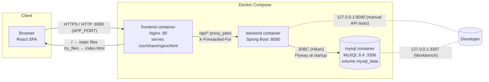

- `docker-compose.yml` publishes only the frontend on all interfaces (`APP_PORT`, default 8080). The backend and
  MySQL are bound to `127.0.0.1`.
- `docker-compose.prod.yml` removes the frontend port and attaches the frontend container to an external
  `web-network`. A shared reverse proxy (`robocare-nginx`) then serves it at `https://benchaaben.olive.robocare.tn`.
  That proxy's configuration is **not** in this repository.

### 4.2 Logical layers

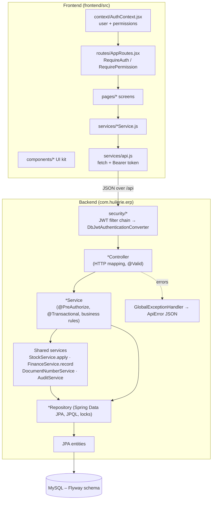

### 4.3 Request lifecycle (authenticated call)

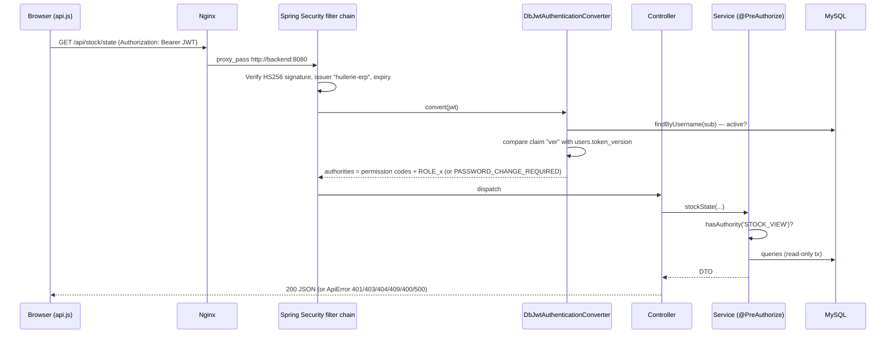

---

## 5. Module inventory

Backend packages live under `backend/src/main/java/com/huilerie/erp/`. Frontend screens live under
`frontend/src/pages/`.

| # | Module | Backend package | Frontend route(s) | Status |
|---|---|---|---|---|
| 1 | Authentication & session | `auth`, `security`, `config` | `/connexion`, `/profil` | Complete (no rate limiting) |
| 2 | Users | `users` (`UserService`) | `/utilisateurs` | Complete |
| 3 | Roles & permissions | `users` (`RoleService`) | `/roles` | Complete (see permission mismatch, §15) |
| 4 | Audit log | `audit` | `/journal` | Complete (no old/new values) |
| 5 | Company settings & reference data | `settings` | `/parametres` | Complete |
| 6 | Catalog (articles, units, categories) | `catalog` | `/catalogue`, `/parametres` | Complete |
| 7 | Customers | `clients` | `/clients` | Complete (no history tab) |
| 8 | Suppliers | `suppliers` | `/fournisseurs` | Complete |
| 9 | Stock, lots & inventories | `inventory` | `/stock` | Complete (single warehouse) |
| 10 | POS quick sales & credit settlements | `sales` | `/ventes/rapide`, `/ventes/historique`, `/finance` (Receivables) | Complete |
| 11 | Sales documents & invoicing | `salesdocs` | `/ventes/devis` … `/ventes/avoirs` | Complete |
| 12 | Purchases | `purchases` | `/achats`, `/finance` (Payables) | Complete (no purchase request / return) |
| 13 | Customer pressing (toll service) | `pressing` | `/pressage` | Complete (oil-share payment not handled) |
| 14 | Production (crushing) | `production` | `/production` | Mostly complete (no reversal after start) |
| 15 | Packaging (bottling) | `packaging` | `/conditionnement` | Complete |
| 16 | Traceability | `traceability` | `/stock` → Trace modal | Partial (sales documents not traced) |
| 17 | Quality control | `quality` | `/qualite` | Complete |
| 18 | Finance & treasury | `finance` | `/finance` | Complete (single cash account) |
| 19 | Human resources & leave | `hr` | `/rh` | Mostly complete |
| 20 | Dashboard | `dashboard` | `/` | Complete |
| 21 | Reports | `reports` | `/rapports` | Complete (POS only for sales, §15) |
| 22 | Notifications | `notifications` | bell icon, `/notifications` | Complete (in-app only) |
| 23 | Global search | `search` | Ctrl+K in top bar | Complete |
| 24 | Shared core (cross-cutting) | `common` (+ numbering, exceptions, validation) | `services/api.js`, `components/*`, `hooks/*` | Complete |
| 25 | Operations (deployment, backup) | — | — | `docker-compose*.yml`, `scripts/*.sh` |

---

## 6. Detailed module analysis

Every module follows the same backend pattern: `XxxController` (HTTP, `@Valid`) → `XxxService` (`@PreAuthorize`,
`@Transactional`, rules) → `XxxRepository` (Spring Data JPA) → entities, with request/response *records* in `dto/`.
Paths below are relative to `backend/src/main/java/com/huilerie/erp/` (backend) and `frontend/src/` (frontend).

### 6.1 Authentication & session

**In business terms.** Staff log in with a username and password. There is no self-registration. After an
administrator creates or resets an account, the user must replace the temporary password before anything else.
"Remember me" keeps the session for 30 days. Otherwise a session lasts 8 hours and the screen logs out after a
configurable idle time.

| Item | Details |
|---|---|
| Purpose | Identify users and issue session tokens that can be revoked. |
| Utility | Blocks anonymous access. Disabling a user or changing a password ends every open session. |
| Functionalities | Login (`rememberMe`), current profile (`/me`), password change (returns a new token), first-admin bootstrap. |
| Roles | Public (`login`). Any authenticated user (`me`, `change-password`). |
| Entities | `AppUser` (`users`), `AuditLog`. |
| Relationships | Uses Users (roles → permissions). Writes audit entries. |
| Frontend | `pages/auth/LoginPage.jsx`, `pages/auth/ChangePasswordPage.jsx`, `context/AuthContext.jsx`, `services/authService.js`, `services/api.js` (`tokenStore`), `routes/ProtectedRoute.jsx`, `hooks/useInactivityLogout.js`, `layouts/MainLayout.jsx`. |
| Backend | `auth/AuthController`, `auth/AuthService`, `security/JwtService`, `security/DbJwtAuthenticationConverter`, `security/SecurityConfig`, `security/JsonSecurityHandlers`, `security/AdminBootstrap`, `config/JwtConfig`. |
| Database | `users.password_hash`, `users.token_version`, `users.must_change_password`, `users.actif`, `users.derniere_connexion`; `audit_logs`. |
| Business rules | **Same error message** for unknown user, wrong password and disabled account (`AuthService.INVALID`), and each failure is logged as `LOGIN_FAILURE`. The JWT holds `sub`, `ver` (token version), `rem` (remember-me), `iss=huilerie-erp`, and an expiry of 480 or 43 200 minutes. It holds **no permissions**; they are loaded from the database on every request. A `ver` mismatch gives a 401 ("Session expirée"). While `must_change_password` is set, the only authority is `PASSWORD_CHANGE_REQUIRED`, so every module returns 403 and the SPA redirects to `/profil`. Password policy (`PasswordPolicy`): 10 to 72 characters with at least one letter and one digit; the new password must differ from the current one. The first admin is created **once**, only when `users` is empty, from `ADMIN_INITIAL_USERNAME` / `ADMIN_INITIAL_PASSWORD` (`AdminBootstrap`). `JWT_SECRET` must be at least 32 bytes or startup fails (`JwtConfig`). The token is kept in `localStorage` (remember-me) or `sessionStorage`. Idle logout is client-side only (`useInactivityLogout`, default 30 min, setting `inactivite_minutes`) and is **disabled when remember-me is used**. |
| Status | **Complete.** Missing: login attempt limiting or lockout, e-mail password reset (both listed as ⬜ in `docs/avancement.md`). |

### 6.2 Users

**In business terms.** An administrator creates staff accounts, assigns roles, edits profile details, resets
passwords, deactivates or reactivates accounts, and can delete an account that was never used.

| Item | Details |
|---|---|
| Purpose | Manage who can use the ERP. |
| Utility | Accounts are never deleted once used, so history is preserved. Only admins can create or modify admins. |
| Functionalities | List, view, create (temporary password), update profile and roles, activate/deactivate, reset password, delete if never logged in. |
| Roles | `USER_MANAGE` for all operations. Creating an admin, or modifying or resetting one, also requires the actor to hold the `ADMIN` role. |
| Entities | `AppUser`, `Role`, `Permission`. |
| Relationships | Referenced by `Sale.caissier`, `Employee.user`, `NotificationRead.user_id`. Most other tables store the **username string** (`cree_par`, `username`, …) rather than a foreign key. |
| Frontend | `pages/users/UsersPage.jsx`, `pages/users/CreateUserModal.jsx`, `services/userService.js`. |
| Backend | `users/UserController`, `users/UserService`, `users/UserRepository`, DTOs `CreateUserRequest`, `UpdateUserRequest`, `UpdateUserStatusRequest`, `ResetPasswordRequest`, `UserResponse`. |
| Database | `users`, `user_roles`. |
| Business rules | Username regex `^[a-z0-9._-]{3,64}$`, stored in lower case and unique. At least one role. You cannot deactivate or delete your own account. The last active admin cannot be deactivated and cannot lose the `ADMIN` role. A physical delete is refused if `derniere_connexion` is set or if the user is an admin. Role changes, deactivation and password resets increment `token_version`, which logs the user out everywhere. Every change is audited (`USER_CREATE`, `USER_UPDATE`, `USER_ACTIVATE`/`USER_DEACTIVATE`, `PASSWORD_RESET`, `USER_DELETE`). |
| Status | **Complete.** |

### 6.3 Roles & permissions

**In business terms.** A role is a named set of permissions. There are 10 built-in (system) roles and 40
permissions. Administrators can create custom roles and edit their permission matrix. The `ADMIN` role always has
every permission.

| Item | Details |
|---|---|
| Purpose | Fine-grained access control per module and per action. |
| Utility | Matches each job to exactly what it needs. Changes take effect on the next request. |
| Functionalities | List permissions, list roles, create, update or delete a role. |
| Roles | `ROLE_MANAGE` (create/update/delete); `ROLE_MANAGE` **or** `USER_MANAGE` (list permissions); `USER_MANAGE` (list roles, through `UserService.listRoles`). |
| Entities | `Role` (`roles`), `Permission` (`permissions`). |
| Frontend | `pages/admin/RolesPage.jsx` (permission matrix), `services/userService.js` (`roles`, `permissions`, `saveRole`, `deleteRole`). |
| Backend | `users/RoleController`, `users/RoleService`, `users/RoleRepository`, `users/PermissionRepository`, DTOs `RoleRequest`, `RoleResponse`, `PermissionResponse`. |
| Database | `roles` (`code`, `nom`, `description`, `systeme`), `permissions` (`code`, `description`), `role_permissions`. |
| Business rules | Role code regex `^[A-Z][A-Z0-9_]{2,63}$`, unique. `ADMIN` cannot be edited. System roles (`systeme=true`) cannot be deleted. A role assigned to users cannot be deleted. Unknown permission codes are rejected. All changes are audited (`ROLE_CREATE`, `ROLE_UPDATE`, `ROLE_DELETE`). Permissions are seeded **only by migrations**; there is no API to create them. |
| Status | **Complete**, with one discrepancy: the `/roles` page is open to `ROLE_MANAGE` holders, but it calls `GET /api/roles`, which requires `USER_MANAGE` (§15.1). |

### 6.4 Audit log

**In business terms.** A read-only history of who did what, when, on which record, and from which IP address.

| Item | Details |
|---|---|
| Purpose | Accountability and investigation. |
| Functionalities | Paged search by user, action prefix, entity type and date range. |
| Roles | `AUDIT_VIEW` (`ADMIN`, `RESP_FINANCIER`). |
| Entities | `AuditLog` (`audit_logs`). |
| Relationships | Every module writes to it through `AuditService.log(...)`. |
| Frontend | `pages/admin/AuditPage.jsx`, `services/auditService.js`. |
| Backend | `audit/AuditController` (it calls the repository directly; there is no service layer for reads), `audit/AuditService`, `audit/AuditLogRepository`. |
| Database | `audit_logs` (`username`, `action`, `entity_type`, `entity_id`, `details` ≤ 1000 characters, `created_at`, `ip`). |
| Business rules | Entries are written in a **separate transaction** (`Propagation.REQUIRES_NEW`), so a failed login is still recorded. The IP is the first value of `X-Forwarded-For` if present, otherwise the remote address. In MySQL, triggers forbid `UPDATE` and `DELETE` (`V5_1__mysql_journaux_append_only.sql`). Page size is capped at 200. |
| Status | **Complete.** Old and new field values are not recorded (acknowledged in `docs/conformite-cdc.md` §26). |

### 6.5 Company settings & reference data

**In business terms.** The mill's legal identity, printed on tickets and invoices, plus the business switches:
whether credit sales are allowed, the default pressing fee per kg, the article used for customer oil, the fiscal
stamp amount and the idle-logout delay. It also holds the VAT rates and the expense categories.

| Item | Details |
|---|---|
| Purpose | Central configuration with no hard-coded business data. |
| Functionalities | Read and update settings; create, update and activate/deactivate taxes and expense categories. |
| Roles | Read: any authenticated user. Write settings and taxes: `SETTINGS_MANAGE`. Expense categories: `SETTINGS_MANAGE` or `FINANCE_MANAGE`. |
| Entities | `CompanySettings` (single row, id = 1), `Tax`, `ExpenseCategory` (class in the `finance` package). |
| Relationships | Read by Sales (credit switch), Pressing (fee, article), Sales documents (fiscal stamp), Purchases and Sales documents (taxes), Finance (expense categories), MainLayout (idle delay), and the print dialogs (header). |
| Frontend | `pages/settings/SettingsPage.jsx` (tabs: company, units, categories, taxes, expense categories), `pages/settings/CompanySettingsForm.jsx`, `pages/settings/SimpleRefTable.jsx`, `services/settingsService.js`, `services/referenceService.js`. |
| Backend | `settings/SettingsController`, `settings/SettingsService`, `settings/ReferenceController`, `settings/ReferenceService`, `settings/CompanySettingsRepository`, `settings/TaxRepository`, `finance/ExpenseCategoryRepository`. |
| Database | `company_settings`, `taxes`, `expense_categories`. |
| Business rules | `company_settings` has `CHECK (id = 1)`. `GET /api/settings` returns `configured=false` when the row does not exist yet, and nothing is invented. The pressing article must be lot-tracked. Fiscal stamp and pressing fee: at most 3 decimals, ≥ 0. Idle delay: 5 to 480 minutes. Tax rate: 0 to 100, unique name. Settings changes are audited (`SETTINGS_UPDATE`); **tax and expense-category status toggles are not**. |
| Status | **Complete.** The currency is fixed to DT in the code. |

### 6.6 Catalog

**In business terms.** The list of everything the mill buys, makes or sells: olives, bulk oil, bottled oil,
packaging, consumables, by-products. Each article has a unit, an optional category, prices, stock thresholds, a
barcode, and two important flags: **saleable at the counter** and **tracked by lot**.

| Item | Details |
|---|---|
| Purpose | Shared article reference data for every flow. |
| Functionalities | Paged and filtered article search, create, update, activate/deactivate. Units and categories CRUD with activation (no delete). |
| Roles | Units and categories, read: authenticated. Articles, read: `CATALOG_VIEW`. Write: `CATALOG_MANAGE`. |
| Entities | `Article` (`articles`), `Unit` (`units`), `Category` (`categories`), enum `ArticleType`. |
| Relationships | Referenced by almost every line table: stock, sales, purchases, production, packaging, quality (through lots), sales documents. |
| Frontend | `pages/catalog/CatalogPage.jsx`, units and categories in `pages/settings/SettingsPage.jsx`, `services/catalogService.js`. |
| Backend | `catalog/CatalogController`, `catalog/CatalogService`, `catalog/ArticleRepository`, `catalog/UnitRepository`, `catalog/CategoryRepository`, DTOs `ArticleDto`, `UnitDto`, `CategoryDto`, `StatusRequest`. |
| Database | `articles` (`reference`, `nom`, `type`, `unite_id`, `categorie_id`, `contenance`, `prix_achat`, `prix_vente`, `seuil_min`, `stock_max`, `code_barres`, `vendable`, `suivi_lot`, `actif`), `units`, `categories`. |
| Business rules | Reference is upper-cased and unique (case-insensitive check). Barcode is unique. A saleable article must have a sale price (service check plus `CHECK ck_articles_vendable_prix`). The unit must be active. **`suivi_lot` cannot change after creation.** `stock_max ≥ seuil_min`. Every decimal is strict to 3 places (`Money.strict`). Logical delete only, through `actif`. |
| Status | **Complete.** |

### 6.7 Customers

**In business terms.** Retail customers, farmers and businesses. A customer may have a credit limit, and the ERP
shows the **outstanding balance** (unpaid POS credit sales plus unpaid invoices).

| Item | Details |
|---|---|
| Purpose | Identify buyers and owners of pressed oil. |
| Functionalities | Paged search (name, code, phone, tax ID), create (auto code `CLI-000001`), update, activate/deactivate, view the balance. |
| Roles | `CLIENT_VIEW` / `CLIENT_MANAGE`. |
| Entities | `Client` (`clients`), enum `ClientType {PARTICULIER, AGRICULTEUR, PROFESSIONNEL}`. |
| Relationships | Used by `Sale`, `SalesDocument`, `Pressing` and `StockLot` (owner of customer lots). The balance is computed from `SaleRepository.outstandingByClient` and `SalesDocumentRepository.outstandingByClient`. |
| Frontend | `pages/clients/ClientsPage.jsx` (through `EntityFormModal`), `services/clientService.js`. |
| Backend | `clients/ClientController`, `clients/ClientService`, `clients/ClientRepository`, `clients/dto/ClientDto`. |
| Database | `clients` (`code`, `type`, `nom`, `telephone`, `adresse`, `cin`, `matricule_fiscal`, `email`, `conditions_paiement`, `plafond_credit`, `actif`). |
| Business rules | A `PROFESSIONNEL` must have a tax ID (`matricule_fiscal`). Credit limit ≥ 0. The code comes from `DocumentNumberService.nextCode("CLIENT","CLI")`. Inactive customers cannot be used in new sales, pressings or documents. |
| Status | **Complete.** There is no history tab on the customer card (history is reached through sales and receivables). `GET /api/clients/{id}` is not used by the UI. |

### 6.8 Suppliers

**In business terms.** Farmers and companies the mill buys from, with bank details.

| Item | Details |
|---|---|
| Purpose | Identify sellers for purchases and payables. |
| Functionalities | Search, create (auto code `FRN-000001`), update, activate/deactivate. |
| Roles | `SUPPLIER_VIEW` / `SUPPLIER_MANAGE`. |
| Entities | `Supplier` (`suppliers`), enum `SupplierType {AGRICULTEUR, ENTREPRISE}`. |
| Relationships | `Purchase.fournisseur`. |
| Frontend | `pages/suppliers/SuppliersPage.jsx`, `services/supplierService.js`. |
| Backend | `suppliers/SupplierController`, `suppliers/SupplierService`, `suppliers/SupplierRepository`, `suppliers/dto/SupplierDto`. |
| Database | `suppliers` (`code`, `type`, `nom`, `telephone`, `adresse`, `cin`, `matricule_fiscal`, `email`, `conditions_paiement`, `banque`, `rib`, `actif`). |
| Business rules | A farmer needs a national ID (CIN) **or** a tax ID. A company needs a tax ID. The bank account number (RIB) must be 20 to 34 digits; spaces are removed before saving. |
| Status | **Complete.** |

### 6.9 Stock, lots & inventories

**In business terms.** The stock screen shows, for each article, the quantity **available for sale**, the
quantity **blocked**, and the quantity **belonging to customers**, broken down by lot. Staff can enter manual
movements (initial stock, entry, exit, adjustments, always with a reason), create lots, block or unblock them, and
run physical inventories that automatically correct the stock to the counted figures.

| Item | Details |
|---|---|
| Purpose | Be the single source of truth for quantities. |
| Utility | Prevents negative stock and selling customer oil, and makes every quantity traceable to a movement. |
| Functionalities | Stock state (with a low-stock filter), movement journal, manual movement, lot list, lot creation, block/unblock, inventories (create snapshot → enter counts → validate or cancel). |
| Roles | `STOCK_VIEW` (read), `STOCK_ADJUST` (manual movements, lots, inventories). |
| Entities | `StockMovement`, `StockBalance`, `StockLot`, `Inventory`, `Inventory.Line` (`InventoryLine`); enums `MovementType`, `LotOwner`, `LotStatus`. |
| Relationships | **`StockService.apply(...)` is the single entry point** used by Sales, Sales documents, Purchases, Pressing, Production, Packaging and Inventory to change stock. |
| Frontend | `pages/stock/StockPage.jsx` (tabs: state, movements, lots, inventories), `MovementModal.jsx`, `LotModal.jsx`, `InventoriesTab.jsx`, `TraceModal.jsx`, `services/stockService.js` (`stockService`, `inventoryService`). |
| Backend | `inventory/StockController`, `inventory/StockService`, `inventory/InventoryController`, `inventory/InventoryService`, repositories `StockBalanceRepository` (pessimistic `lockFor`), `StockMovementRepository`, `StockLotRepository`, `InventoryRepository`. |
| Database | `stock_movements`, `stock_balances`, `stock_lots`, `inventories`, `inventory_lines`. |
| Business rules | (1) `apply` runs only inside an existing transaction (`Propagation.MANDATORY`). It locks the `(article, lot_ref)` balance row with `SELECT … FOR UPDATE`, rejects quantities ≤ 0 or with more than 3 decimals, rejects a lot that belongs to another article, requires a lot for lot-tracked articles and forbids one otherwise, and refuses a negative result ("Stock insuffisant…"). The database repeats the check with `CHECK (quantite >= 0)`. (2) `STOCK_INITIAL` is accepted only when no balance row exists yet. (3) Manual movements may use only types flagged `manual` (`STOCK_INITIAL`, `ENTREE`, `SORTIE`, `AJUSTEMENT_PLUS`, `AJUSTEMENT_MOINS`), need a reason, and need an active article. (4) A lot number is unique per article. `ENTREPRISE` lots have no customer; `CLIENT` lots must have one (`CHECK ck_stock_lots_proprietaire`). Blocking requires a reason. (5) "Available" = balances with no lot, or with an `ENTREPRISE` + `DISPONIBLE` lot. A low-stock alert is raised when available < `seuil_min`. (6) Inventory: creating it snapshots the theoretical quantities (lot-tracked articles: one line per lot with positive stock). Validating it applies `INVENTAIRE_PLUS`/`INVENTAIRE_MOINS` for the **difference against the stock at validation time**, which absorbs sales made during counting. Lines left uncounted are skipped. At least one counted line is required, and a closed inventory cannot be changed. (7) In MySQL, triggers make `stock_movements` append-only. |
| Status | **Complete** for one warehouse. Multi-warehouse stock and transfers are not implemented (decision 12 in `docs/decisions.md`). |

### 6.10 POS quick sales & credit settlements

**In business terms.** The cashier scans or picks products, chooses the lot if needed, optionally applies a
discount or a price override (with the right permission), takes payment in cash, card, transfer or cheque (mixed
payments allowed, change returned only on cash) and validates with **F9**. The ticket is printed in 80 mm, 58 mm or
A4. If the customer pays only part, the rest becomes **credit**, but only for an identified customer, when credit
is enabled in settings, and within the credit limit. Later payments of credit sales are recorded from the
Receivables tab in Finance.

| Item | Details |
|---|---|
| Purpose | Fast counter sales with correct stock and cash. |
| Functionalities | Saleable catalog (available stock per lot, FIFO order), create sale (idempotent), history with filters, detail, print/reprint counter, cancel (compensating entries), receivables by customer, open credits per customer, settle. |
| Roles | `SALES_CREATE` (catalog, create). `SALES_VIEW` (history, detail, print, cashiers). `SALES_CANCEL`. `SALES_DISCOUNT` and `SALES_PRICE_OVERRIDE` (checked inside the sale). Receivables: `SALES_VIEW` or `FINANCE_VIEW`. Settle: `SALES_CREATE` or `FINANCE_MANAGE`. |
| Entities | `Sale`, `SaleLine`, `SalePayment`, `ClientPayment`; enums `SaleStatus`, `PaymentMode`. |
| Relationships | Calls `StockService.apply(VENTE / ANNULATION_VENTE)`, `FinanceService.record(ENCAISSEMENT / DECAISSEMENT)`, `SettingsService.creditAllowed()`, `DocumentNumberService` (`TCK`, `RGL`). Read by Dashboard, Reports, Traceability, Search and Customers (balance). |
| Frontend | `pages/sales/QuickSalePage.jsx`, `SalesHistoryPage.jsx`, `SaleDetailModal.jsx`, `Ticket.jsx`, `TicketPrintDialog.jsx`, `pages/finance/ReceivablesTab.jsx`, `hooks/useIdempotencyKey.js`, `services/salesService.js` (`salesService`, `creditService`). |
| Backend | `sales/SaleController`, `sales/SaleService`, `sales/SaleCalculator` (pure calculation, unit-tested), `sales/SaleRepository`, `sales/ClientPaymentRepository`, `sales/dto/SaleDto`. |
| Database | `sales`, `sale_lines`, `sale_payments`, `client_payments`. |
| Business rules | **One transaction** covers number, lines, stock exits, payments and cash entries, so nothing is half-saved and no number is lost. **Idempotency**: `idempotency_key` is unique, and the same key returns the existing sale. Articles must be active and saleable. Lots must not be `CLIENT` or `BLOQUE`. The price defaults to the catalog price; any other price requires `SALES_PRICE_OVERRIDE`. Any discount requires `SALES_DISCOUNT` and cannot exceed the subtotal. Non-cash payments cannot exceed the total; only cash produces change. If something remains to pay, the sale needs a customer, credit must be enabled, and the customer's outstanding POS credit plus this remainder must stay within `plafond_credit`. Database checks enforce `total = sous_total − remise`, `montant_paye + reste_a_payer = total`, and that credit requires a customer. **Printing** only increments `nb_impressions` and logs `TICKET_PRINT`/`TICKET_REPRINT`; the ticket shows "DUPLICATA" from the second print. **Cancellation** requires a reason, is refused if the sale has later settlements, puts each line back in stock and refunds each payment as a cash `DECAISSEMENT`. **Settlement** is capped at the remaining amount, records a `ClientPayment` (`RGL-…`) and a cash `ENCAISSEMENT`, and never changes the sale total. In MySQL, `sale_lines` cannot be updated and `client_payments` cannot be updated. |
| Status | **Complete.** |

### 6.11 Sales documents & invoicing

**In business terms.** The formal B2B cycle. Draft a **quote**, turn it into an **order**, then a **delivery note**
(stock leaves at this point), then an **invoice** (VAT plus fiscal stamp, numbered on validation, with a due date
and partial payments). A validated invoice can be cancelled only with a **credit note**, which can refund the
customer and optionally return the goods to stock. Invoices print as A4 (and can be saved as PDF from the browser),
with the amount written out in words.

| Item | Details |
|---|---|
| Purpose | Quote-to-cash with legal invoices. |
| Functionalities | Paged list per document type, detail with related documents, create or update a draft, validate, transform (quote → order or invoice; order → delivery or invoice; delivery → invoice), pay an invoice, issue a credit note, cancel. |
| Roles | Read: `SALES_VIEW`. Write: `SALESDOC_MANAGE`. Validating an invoice also needs `INVOICE_VALIDATE`. Credit note: `INVOICE_VALIDATE`. Pay: `SALESDOC_MANAGE` or `FINANCE_MANAGE`. |
| Entities | `SalesDocument`, `SalesDocument.Line`, `SalesDocument.Payment`; enums `SalesDocument.Type {DEVIS, COMMANDE, LIVRAISON, FACTURE, AVOIR}`, `SalesDocument.Status {BROUILLON, VALIDE, TRANSFORME, ANNULE}`. |
| Relationships | Stock (`LIVRAISON`, `RETOUR_CLIENT`, `ANNULATION_PLUS`), Finance (payments and refunds), Settings (fiscal stamp), Taxes, Customers (credit limit, which combines POS and invoice balances), Notifications (overdue invoices), Dashboard, Search. Reuses `PurchaseService.lineHt/lineTva` for line maths. |
| Frontend | `pages/salesdocs/SalesDocsPage.jsx` (one page, `type` prop per route), `SalesDocFormModal.jsx`, `SalesDocDetailModal.jsx`, `SalesDocPrint.jsx` (amount in words), `components/print/DocPrintDialog.jsx`, `services/salesDocService.js`. |
| Backend | `salesdocs/SalesDocumentController`, `salesdocs/SalesDocumentService`, `salesdocs/SalesDocumentRepository`, `salesdocs/dto/SalesDocDto`. |
| Database | `sales_documents` (self-reference `source_id`), `sales_document_lines`, `sales_document_payments`. |
| Business rules | A credit note cannot be created directly. A draft has no number; **the number is assigned at validation** (prefixes `DEV`, `CMD`, `BL`, `FAC`, `AVR`). The due date cannot precede the document date. Only drafts can be edited, and the type cannot change. The line price defaults to the catalog price. Line HT = qty × unit price × (1 − discount%), VAT = HT × rate. Invoice validation adds the configured fiscal stamp. Orders and invoices check the credit limit against POS balance + invoice balance + this document's total. **Stock leaves exactly once**: when a delivery note is validated, or when an invoice whose source is not a delivery note is validated. Lots must be saleable. A transformation copies the lines into a new draft and marks the source `TRANSFORME`. Cancelling a draft that came from a transformation reopens the source (`VALIDE`). Cancelling a validated delivery note puts the goods back (`ANNULATION_PLUS`). A validated invoice cannot be cancelled except by a credit note, and a credit note cannot be cancelled. A payment applies only to a validated invoice and is capped at the remaining amount. A credit note copies every line (it is always a full credit note), is validated at once, optionally returns stock, refunds the amount already paid with the chosen mode, and sets the invoice to `ANNULE`. Database check: `total_ttc = total_ht + total_tva + timbre`, and a numbered status requires a number. |
| Status | **Complete.** Partial credit notes are not supported. Inactive taxes are not rejected here, unlike in Purchases (§15). |

### 6.12 Purchases

**In business terms.** Create a purchase order for a supplier (lines with discount and VAT), validate it, receive
goods in one or more deliveries (entering a lot number for lot-tracked articles such as olives), record the
supplier's invoice reference, and pay in one or more instalments.

| Item | Details |
|---|---|
| Purpose | Procurement and supplier payables. |
| Functionalities | Search (with an unpaid filter), detail, create or update a draft, validate, cancel, set the invoice reference, receive, pay, payables per supplier. |
| Roles | `PURCHASE_VIEW`, `PURCHASE_CREATE` (draft), `PURCHASE_VALIDATE` (validate/cancel), `PURCHASE_RECEIVE`, `FINANCE_MANAGE` (pay). Invoice reference: `PURCHASE_CREATE` or `FINANCE_MANAGE`. Payables: `PURCHASE_VIEW` or `FINANCE_VIEW`. |
| Entities | `Purchase`, `PurchaseLine`, `GoodsReceipt`, `GoodsReceipt.Line` (`GoodsReceiptLine`), `SupplierPayment`; enum `PurchaseStatus`. |
| Relationships | Stock (`RECEPTION_ACHAT`, lot creation as `ENTREPRISE`), Finance (`DECAISSEMENT`), Taxes, Suppliers, Catalog. The olive lots it creates feed Production. |
| Frontend | `pages/purchases/PurchasesPage.jsx`, `PurchaseFormModal.jsx`, `PurchaseDetailModal.jsx`, `pages/finance/PayablesTab.jsx`, `services/purchaseService.js`. |
| Backend | `purchases/PurchaseController`, `purchases/PurchaseService`, `purchases/PurchaseRepository`, `purchases/GoodsReceiptRepository`, `purchases/SupplierPaymentRepository`, `purchases/dto/PurchaseDto`. |
| Database | `purchases`, `purchase_lines`, `goods_receipts`, `goods_receipt_lines`, `supplier_payments`. |
| Business rules | The number `ACH-YYYY-…` is assigned **at draft creation**. The supplier and articles must be active, and taxes must be active. Totals are recomputed on the server. Only drafts can be edited or validated. Cancellation is allowed only in `BROUILLON` or `VALIDEE` with no payment. A receipt is allowed only in `VALIDEE` or `PARTIELLEMENT_RECUE`; the same line may not appear twice; the quantity cannot exceed what remains. Lot-tracked articles need a lot number: an existing `ENTREPRISE` lot is reused, otherwise one is created, and a clash with a customer lot is rejected. The status is recomputed as `PARTIELLEMENT_RECUE` or `RECUE`. A payment is allowed only after validation and is capped at `total_ttc − montant_paye`. Database checks: `total_ttc = total_ht + total_tva`, `montant_paye ≤ total_ttc`, `quantite_recue ≤ quantite`. In MySQL, `supplier_payments` and `goods_receipt_lines` cannot be updated. |
| Status | **Complete.** Not implemented: a separate purchase-request step and supplier returns. Receipts **do not update `articles.prix_achat`**, which stock valuation relies on (§15). `PATCH /purchases/{id}/invoice-ref` exists but **no UI calls it** (the reference can still be entered in the draft form). |

### 6.13 Customer pressing (toll service)

**In business terms.** A farmer brings olives. The mill weighs them (gross, tare, net), records variety, origin and
condition (healthy, fallen, damaged), and prints a weighing slip. The fee is net kg × rate. After pressing, the oil
obtained goes into a **lot owned by the customer**, numbered like the pressing. The customer pays the fee in one or
more instalments, and only then can the oil be handed over, in one or more pick-ups with a printed return slip.

| Item | Details |
|---|---|
| Purpose | Run the toll-pressing service without mixing customer oil with mill stock. |
| Functionalities | Search, detail, receive and weigh, start, finish (oil obtained, losses), pay, return oil (partial), cancel. |
| Roles | `PRESSING_VIEW`, `PRESSING_MANAGE`. Pay: `PRESSING_MANAGE` or `SALES_CREATE` (so the cashier can collect, and the cashier role was given `PRESSING_VIEW` in V7). |
| Entities | `Pressing`, `Pressing.Return` (`PressingReturn`), `Pressing.Payment` (`PressingPayment`); enums `Pressing.Status {RECU, EN_COURS, TERMINE, REMIS, ANNULE}`, `Pressing.OliveState`. |
| Relationships | Customers, Settings (default article and fee), Stock (`PRESSAGE_ENTREE`, `PRESSAGE_REMISE` on a `CLIENT` lot), Finance (`ENCAISSEMENT`), Traceability, Reports (yield by variety), Dashboard, Notifications. |
| Frontend | `pages/pressing/PressingPage.jsx`, `ReceptionModal.jsx`, `PressingDetailModal.jsx`, `PressingTickets.jsx` (weighing and return slips), `services/operationsService.js` (`pressingService`). |
| Backend | `pressing/PressingController`, `pressing/PressingService`, `pressing/PressingRepository`, `pressing/dto/PressingDto`. |
| Database | `pressings`, `pressing_returns`, `pressing_payments`. |
| Business rules | Customer must be active. The article comes from the request or from `company_settings.pressage_article_id` and must be lot-tracked. The fee comes from the request or from `company_settings.tarif_pressage_kg`. Tare < gross; net = gross − tare (also a DB check). Amount = net × rate. Status machine: `RECU → EN_COURS → TERMINE → REMIS`, and `ANNULE` only from `RECU`/`EN_COURS` with nothing paid. Finishing creates a `CLIENT` lot whose number is the pressing number. **Oil can be returned only once the fee is fully paid**, and never more than remains. The status becomes `REMIS` when all the oil has been returned. Payment is capped at the remainder. Yield = oil × 100 / net kg. |
| Status | **Complete.** Paying with a share of the oil is **not handled** (`docs/decisions.md` §21). |

### 6.14 Production (crushing)

**In business terms.** The production manager plans a crushing run on a date and line, chooses the mill's olive
lots and the oil article to produce, starts the run (the olives leave stock), then finishes it. Finishing records
the litres of oil (into a new lot, optionally blocked until a lab analysis), the losses, the acidity (which gives an
indicative category: extra virgin ≤ 0.8 %, virgin ≤ 2 %, ordinary ≤ 3.3 %, otherwise lampante) and the
by-products. The yield is computed in litres per 100 kg.

| Item | Details |
|---|---|
| Purpose | Turn the mill's own olives into saleable oil, with yield tracking. |
| Functionalities | Search, detail, plan or update, start, finish, cancel (planned orders only). |
| Roles | `PRODUCTION_VIEW`, `PRODUCTION_MANAGE`. |
| Entities | `ProductionOrder`, `ProductionOrder.Input` (`ProductionInput`), `ProductionOrder.ByProduct` (`ProductionByProduct`); enums `ProductionOrder.Status {PLANIFIE, EN_COURS, TERMINE, ANNULE}`, `OilCategory`. |
| Relationships | Stock (`CONSOMMATION_PRODUCTION` at start; `PRODUCTION_SORTIE` for oil and by-products at finish), Purchases (olive lots), Quality (lot blocked pending analysis), Packaging (the oil lot is the source), Traceability, Reports, Dashboard. |
| Frontend | `pages/production/ProductionPage.jsx`, `ProductionFormModal.jsx`, `ProductionDetailModal.jsx`, `services/operationsService.js` (`productionService`). |
| Backend | `production/ProductionController`, `production/ProductionService`, `production/ProductionOrderRepository`, `production/OilCategory`, `production/dto/ProductionDto`. |
| Database | `production_orders`, `production_inputs`, `production_byproducts`. |
| Business rules | Number `PRD-YYYY-…` at planning. The oil article must be lot-tracked. Inputs must be `OLIVES` articles, and lots must be `ENTREPRISE` (customer olives are refused: "utilisez le pressage"). `olives_kg` is the sum of the inputs. Only `PLANIFIE` orders can be edited or cancelled. Starting consumes every input and fails as a whole if stock is short. Finishing: the lot number defaults to the order number, must be unique for the article, and the lot is optionally blocked. By-products must not be lot-tracked. Yield = litres × 100 / kg. The category comes from the acidity via `OilCategory.fromAcidity`. |
| Status | **Mostly complete.** Not implemented: a blocking mass-balance check, an alert on olive waiting time before crushing (`docs/avancement.md`), and **any way to cancel or reverse an order that is `EN_COURS`** (the olives are already consumed, §15). |

### 6.15 Packaging (bottling)

**In business terms.** Turn bulk oil into bottles or cans. The user picks the bulk oil (and its lot), the finished
product (an article whose `contenance` gives litres per unit) and the quantity. The ERP removes quantity × capacity
litres of bulk oil and the packaging used (bottles, caps, labels), and adds the finished goods. A lot-tracked
finished product inherits the bulk lot number. A packaging order can be cancelled, which posts reverse movements.

| Item | Details |
|---|---|
| Purpose | Make saleable finished goods while keeping lot traceability. |
| Functionalities | Search, create (atomic), cancel. |
| Roles | `PACKAGING_VIEW`, `PACKAGING_MANAGE`. |
| Entities | `PackagingOrder`, `PackagingOrder.Consumption` (`PackagingConsumption`). |
| Relationships | Stock (`CONDITIONNEMENT_SORTIE`, `CONDITIONNEMENT_ENTREE`, `ANNULATION_PLUS`, `ANNULATION_MOINS`), Catalog (`contenance`), Traceability, Reports. |
| Frontend | `pages/packaging/PackagingPage.jsx`, `PackagingModal.jsx`, `services/operationsService.js` (`packagingService`). |
| Backend | `packaging/PackagingController`, `packaging/PackagingService`, `packaging/PackagingOrderRepository`, `packaging/dto/PackagingDto`. |
| Database | `packaging_orders`, `packaging_consumptions`. |
| Business rules | The finished product needs a `contenance` and must differ from the source. The source lot must be `ENTREPRISE` and not `BLOQUE`. A lot-tracked finished product requires a source lot; its lot (same number) is found or created. Packaging materials must not be lot-tracked. Volume = quantity × capacity, rounded to 3 decimals. Cancelling removes the finished goods first, so **it fails if they were already sold** (insufficient stock), then puts back the packaging and the bulk oil. Status is `VALIDE` or `ANNULE`. |
| Status | **Complete.** |

### 6.16 Traceability

**In business terms.** From any lot, see where it came from (supplier receipt, customer pressing, crushing of olive
lots, bulk lot used for bottling) and where it went (crushing, bottling, POS sales, returns to the customer), plus
its full movement history. The user can click through from lot to lot.

| Item | Details |
|---|---|
| Purpose | Food-safety recall and audit. |
| Functionalities | `GET /api/traceability/lots/{id}` returns upstream links, downstream links and movements (first 200). |
| Roles | `STOCK_VIEW` or `PRODUCTION_VIEW`. |
| Entities | Read-only joins over `GoodsReceiptLine`, `Pressing`, `ProductionOrder` and its inputs, `PackagingOrder`, `SaleLine`, `Pressing.Return`, `StockMovement`. |
| Frontend | `pages/stock/TraceModal.jsx` (opened from the lots tab), `services/operationsService.js` (`traceService`). |
| Backend | `traceability/TraceabilityController`, `traceability/TraceabilityService` (JPQL through `EntityManager`). |
| Business rules | Excludes cancelled production and packaging orders and cancelled POS sales. |
| Status | **Partial.** **Sales documents** (delivery notes and invoices with a lot) and **quality controls** do not appear in the trace, although `sales_document_lines.lot_id` exists. The downstream view therefore misses B2B deliveries (§15). |

### 6.17 Quality control

**In business terms.** The quality manager defines criteria with acceptable ranges (for example acidity
0–0.8 %, peroxide index ≤ 20). They record a control on a lot with one value per criterion. The control is
conforming only if every value is within range. With **"apply decision"** checked, a non-conforming lot is blocked
and a major anomaly is opened, and a conforming lot that was blocked is released. Anomalies (minor, major,
critical) move from open to in progress to closed, and closing one requires a corrective action.

| Item | Details |
|---|---|
| Purpose | Make sure only conforming oil can be sold. |
| Functionalities | Criteria CRUD and activation; controls (record, search); anomalies (create, update status, search). |
| Roles | `QUALITY_VIEW`, `QUALITY_MANAGE` (`RESP_QUALITE`, `RESP_PRODUCTION`, `ADMIN`). |
| Entities | `QualityCriterion`, `QualityControl`, `QualityControl.Result` (`quality_results`), `QualityAnomaly`. |
| Relationships | Changes `StockLot.statut` (block/unblock), which then affects Sales, Sales documents and Packaging. Feeds Notifications. |
| Frontend | `pages/quality/QualityPage.jsx` (tabs: controls, criteria, anomalies), `services/operationsService.js` (`qualityService`). |
| Backend | `quality/QualityController`, `quality/QualityService`, repositories `QualityCriterionRepository`, `QualityControlRepository`, `QualityAnomalyRepository`, `quality/QualityDto`. |
| Database | `quality_criteria`, `quality_controls`, `quality_results`, `quality_anomalies`. |
| Business rules | Criterion name is unique, needs a min or a max (also a DB check), and min ≤ max. A control needs at least one result, no criterion twice, and only active criteria. Conformity is computed by `QualityCriterion.accepts(v)`. Gravity is restricted to `MINEURE`/`MAJEURE`/`CRITIQUE` and status to `OUVERTE`/`EN_COURS`/`CLOTUREE` (regex in the DTO and a DB check). Closing requires a corrective action and sets `cloture_le`. |
| Status | **Complete.** A conforming control unblocks the lot **whatever the original reason for the block** (for example a manual block). |

### 6.18 Finance & treasury

**In business terms.** A single cash register. A cashier opens the till with a float. During the day every cash
receipt or payment from any module is written to the **cash journal**. At closing, the cashier counts the cash, the
ERP compares it with the theoretical amount (float + cash in − cash out), and any difference must be explained.
Finance staff record **expenses** (cancelled by reversal, never deleted), and see **receivables** (POS credit
sales) and **payables** (unpaid purchases).

| Item | Details |
|---|---|
| Purpose | Cash control and expense tracking. |
| Functionalities | Cash journal with totals (income, outgoings, balance, cash only); current session, session history, open, close; expenses search, create, cancel. |
| Roles | Journal and expenses read: `FINANCE_VIEW`. Expenses write: `FINANCE_MANAGE`. Sessions read: `CASH_SESSION` or `FINANCE_VIEW`; open/close: `CASH_SESSION`. |
| Entities | `CashMovement`, `CashSession`, `Expense`, `ExpenseCategory`; enums `CashMovementType`, `PaymentMode`. |
| Relationships | **`FinanceService.record(...)`** is called by Sales, Sales documents, Purchases, Pressing and Treasury. Dashboard and Reports read the cash journal. |
| Frontend | `pages/finance/FinancePage.jsx` (tabs shown by permission), `CashSessionTab.jsx`, `CashJournalTab.jsx`, `ExpensesTab.jsx`, `ReceivablesTab.jsx`, `PayablesTab.jsx`, `services/financeService.js`. |
| Backend | `finance/FinanceController`, `finance/FinanceService`, `finance/TreasuryController`, `finance/TreasuryService`, repositories `CashMovementRepository`, `CashSessionRepository`, `ExpenseRepository`, `ExpenseCategoryRepository`, `finance/dto/CashDto`. |
| Database | `cash_movements`, `cash_sessions`, `expenses`, `expense_categories`. |
| Business rules | `record` runs only inside an existing transaction (`MANDATORY`). Amount > 0 (DB check). **Only one open session**: `ouverte_flag = 1` with a unique index, set to NULL on close. Sales are possible **without** an open session (decision 16). Theoretical cash = float + `ESPECES` receipts − `ESPECES` payments since opening, from **every** module. A non-zero difference needs a justification. An expense needs an active category and a date no later than *tomorrow* (the message says "pas dans le futur"). Cancelling an expense posts an `ENCAISSEMENT` of the same amount. In MySQL, `cash_movements` is append-only. |
| Status | **Complete.** Only one cash account exists; separate bank accounts are not handled (`docs/conformite-cdc.md` §21). |

### 6.19 Human resources & leave

**In business terms.** HR keeps employee files: auto-numbered `EMP-000001`, identity, department, position, hire
date, contract type and end date, status, leave balance, and an optional link to an ERP login. Employees whose
login is linked request leave. The ERP counts **working days** (Monday to Friday, minus public holidays), checks for
overlaps and the balance (for annual leave), and a manager approves or rejects it, giving a reason for a rejection.
Nobody can approve their own request. Approved annual leave is deducted from the balance. HR also records
absences (half or full day) and public holidays.

| Item | Details |
|---|---|
| Purpose | Staff records and leave workflow. |
| Functionalities | Departments and positions (list, add, rename), employees (search, create, update), my employee file, leave (search, request, decide, cancel), working-day calculator, absences (search, record), holidays (list, add, delete). |
| Roles | `HR_VIEW`, `HR_MANAGE`, `LEAVE_REQUEST` (own requests; given to every role in V8), `LEAVE_VALIDATE`. |
| Entities | `Employee`, `HrRef.Service` (`hr_services`), `HrRef.Position` (`hr_positions`), `LeaveRequest`, `Absence`, `PublicHoliday`. |
| Relationships | `Employee.user` → `AppUser`. Feeds Dashboard (active staff, pending leave), Notifications (contracts ending within 30 days, pending leave) and Search. |
| Frontend | `pages/hr/HrPage.jsx` (sections adapt to `HR_VIEW`, `HR_MANAGE` and `LEAVE_VALIDATE`), `services/operationsService.js` (`hrService`). It also calls `userService.list` to link accounts. |
| Backend | `hr/HrController`, `hr/HrService`, repositories `EmployeeRepository`, `LeaveRequestRepository`, `AbsenceRepository`, `PublicHolidayRepository`, `HrServiceRepository`, `HrPositionRepository`, `hr/HrDto`. |
| Database | `employees`, `hr_services`, `hr_positions`, `leave_requests`, `absences`, `public_holidays`. |
| Business rules | `CDD`, `SAISONNIER` and `STAGE` contracts need an end date, which must be on or after the hire date (also a DB check). A login can be linked to only one employee (unique `user_id`). A leave request needs an `ACTIF` employee, end ≥ start, at least one working day, no overlap with `EN_ATTENTE`/`VALIDEE` requests, and enough balance for `CONGE_ANNUEL`. HR (`HR_MANAGE`) may request on behalf of an employee. A decision applies only to `EN_ATTENTE` requests; the approver cannot be the requester; approval re-checks the balance and deducts it; rejection needs a reason. Only pending requests can be cancelled, by the requester or HR. Absence: one per employee per day, duration 0.5 or 1.0. Holiday date is unique. Without `HR_VIEW`/`LEAVE_VALIDATE`, the leave list is limited to the user's own file. |
| Status | **Mostly complete.** Not implemented: automatic leave accrual (the balance is entered by hand), cancelling an **approved** leave with the balance restored, deactivating departments or positions (the `actif` column exists but there is no endpoint), and a duplicate-name check on rename (the DB constraint catches it as a 409). Holidays, leave cancellation and department/position changes are **not audited**. |

### 6.20 Dashboard

**In business terms.** The home page shows KPI tiles and lists, and each block appears only if the user may see
that module. Examples: today's and this month's POS sales, the last 7 days chart, net cash today, receivables,
payables, open purchase orders, monthly expenses, cash-session status and cash in the drawer, low-stock and
blocked lots, pressings in progress, oil to return and unpaid pressing fees, production this month with yield,
invoices outstanding and invoiced this month, active employees and leave awaiting approval.

| Item | Details |
|---|---|
| Roles | `DASHBOARD_VIEW`, plus each block's own permission (`SALES_VIEW`, `FINANCE_VIEW`, `STOCK_VIEW`, …). |
| Frontend | `pages/dashboard/DashboardPage.jsx`, `components/common/StatCard.jsx`, `services/dashboardService.js`. |
| Backend | `dashboard/DashboardController`, `dashboard/DashboardService`, `dashboard/dto/DashboardResponse`. A null field means "not allowed". |
| Business rules | Days are computed in `Africa/Tunis`. Yield = oil × 100 / olives kg. |
| Status | **Complete.** "Invoiced this month" includes **cancelled** invoices (§15). |

### 6.21 Reports

**In business terms.** Reports for a period of up to 400 days:

- **sales**: revenue, ticket count, average basket, discounts, cancellations, per day, per article, per customer
  and per cashier;
- **purchases**: per supplier, plus payables;
- **valued stock**: at the last purchase price entered on the article, flagging articles with no price;
- **finance**: income and outgoings per payment mode, expenses per category, receivables and payables;
- **production**: crushing totals and yield, litres per oil category, pressing totals and yield per variety,
  bottling per product.

Every report exports to CSV (`;` separator, Excel-compatible) and prints to PDF through the browser.

| Item | Details |
|---|---|
| Roles | `REPORT_VIEW`. |
| Frontend | `pages/reports/ReportsPage.jsx`, `utils/exportCsv.js`, `services/reportService.js`. |
| Backend | `reports/ReportController`, `reports/ReportService`, `reports/ReportDto`. Uses `StockService.stockStateUnchecked` (bypasses `STOCK_VIEW`; the service checks `REPORT_VIEW` itself). |
| Business rules | The range must be valid and ≤ 400 days. Days are grouped in `Africa/Tunis`. Only validated sales are counted. |
| Status | **Complete**, but the sales report and the finance report's receivables cover **POS tickets only**, not invoices (§15). There is no user-activity report (⬜ in `docs/avancement.md`). |

### 6.22 Notifications

**In business terms.** A bell icon in the top bar and a notifications page list **computed alerts**, each
filtered by permission:

- out of stock or low stock;
- blocked lots;
- overdue invoices;
- pressings waiting for the oil to be returned;
- purchase orders to receive and drafts to validate;
- leave requests pending;
- contracts ending within 30 days;
- open quality anomalies.

The user can mark them as read.

| Item | Details |
|---|---|
| Roles | Any authenticated user (each content block checks its own permission). |
| Entities | `NotificationRead` (`notification_reads`): only the "read" state is stored. |
| Frontend | `components/layout/NotificationBell.jsx`, `pages/NotificationsPage.jsx`, `services/operationsService.js` (`notificationService`). |
| Backend | `notifications/NotificationController`, `notifications/NotificationService`, `notifications/NotificationReadRepository`. |
| Business rules | Each notification key encodes its *state* (for example `STOCK:{articleId}:{available}` or `CONGES:{count}:{date}`), so a changed situation produces a new unread alert. Keys are truncated to 120 characters. |
| Status | **Complete** in-app. No e-mail, SMS or WhatsApp delivery (listed as a future evolution). |

### 6.23 Global search

**In business terms.** Press Ctrl+K and type at least 2 characters to search customers, suppliers, articles, lots,
POS tickets, sales documents, purchases, pressings, production orders and employees. Each section is filtered by
permission and limited to 6 results, and each result links to its module page.

| Item | Details |
|---|---|
| Frontend | `components/layout/GlobalSearch.jsx`, `services/operationsService.js` (`searchService`). |
| Backend | `search/SearchController`, `search/SearchService` (JPQL `LIKE`, `setMaxResults(6)`). |
| Status | **Complete.** Results link to the module page, not to the exact record. |

### 6.24 Shared core (cross-cutting)

| Component | Role |
|---|---|
| `common/Money` | `BigDecimal` with 3 decimals. `strict()` rejects more than 3 decimals instead of rounding. `ofAny()` normalises aggregate results. |
| `common/Text` | Trims strings and turns empty values into null. `search()` lower-cases search terms. |
| `common/SecurityUtils` | Current username (`"system"` when there is none) and `has(authority)`. |
| `common/numbering/DocumentNumberService` + `DocumentSequence` | Gap-free numbers (`PREFIX-YYYY-000001` yearly, or `PREFIX-000001` permanent). The row is locked with `PESSIMISTIC_WRITE` and the call must run inside the caller's transaction (`MANDATORY`). |
| `common/exception/*` | `BusinessException` → 409 `REGLE_METIER`, `NotFoundException` → 404, and `GlobalExceptionHandler` mapping validation (400), unreadable body (400), integrity violation (409 `CONTRAINTE`), lock timeout (409 `OCCUPE`), auth (401), access (403) and anything else (500 with no detail exposed). |
| `common/response/ApiError`, `PageResponse` | Single error format and single page format. |
| `common/validation/PasswordPolicy`, `ValidationPatterns` | Password and username rules. |
| Frontend `services/api.js` | One `fetch` wrapper: adds the bearer token, converts errors to `ApiError` with `fieldErrors`, and on a 401 clears the token and dispatches `auth:expired`. |
| Frontend `components/*` | UI kit: `DataTable`, `Pagination`, `Toolbar`, `Modal`, `ConfirmDialog`, `EntityFormModal`, `FormFields`, `RemoteSelect`, `ManagedList`, `Tabs`, `StatusBadge`, `StatCard`, `PageHeader`, `Sidebar`, `Topbar`, `DocPrintDialog`. |
| Frontend `hooks/*` | `usePagedList` (debounced, server-side paging), `useIdempotencyKey`, `useInactivityLogout`, `usePermission`. |
| Frontend `utils/*` | `format.js`, `money.js`, `labels.js`, `exportCsv.js`, `navigation.js` (menu), `roles.js`. |

---

## 7. Entity inventory

There are **54 tables**, created by Flyway migrations `V1`–`V8` in `backend/src/main/resources/db/migration`.
52 are mapped by a JPA entity and 2 are pure join tables. Hibernate runs with `ddl-auto: validate`, so entities and
SQL must match exactly.

| # | Table | JPA class | Domain | Migration | Kind |
|---|---|---|---|---|---|
| 1 | `users` | `users.AppUser` | Security | V1, V6 | Master |
| 2 | `roles` | `users.Role` | Security | V1, V6 | Reference |
| 3 | `permissions` | `users.Permission` | Security | V1 | Technical reference (seeded) |
| 4 | `user_roles` | (join table of `AppUser.roles`) | Security | V1 | Association |
| 5 | `role_permissions` | (join table of `Role.permissions`) | Security | V1 | Association |
| 6 | `audit_logs` | `audit.AuditLog` | Audit | V1, V8 | Append-only journal |
| 7 | `company_settings` | `settings.CompanySettings` | Settings | V3, V7, V8 | Singleton |
| 8 | `document_sequences` | `common.numbering.DocumentSequence` | Core | V3 | Technical counter |
| 9 | `units` | `catalog.Unit` | Catalog | V3 | Reference |
| 10 | `categories` | `catalog.Category` | Catalog | V3 | Reference |
| 11 | `articles` | `catalog.Article` | Catalog | V3, V8 | Master (central) |
| 12 | `clients` | `clients.Client` | Customers | V3, V8 | Master (central) |
| 13 | `suppliers` | `suppliers.Supplier` | Suppliers | V3, V8 | Master |
| 14 | `stock_lots` | `inventory.StockLot` | Stock | V4 | Master (central) |
| 15 | `stock_balances` | `inventory.StockBalance` | Stock | V4 | Projection |
| 16 | `stock_movements` | `inventory.StockMovement` (`@Immutable`) | Stock | V4 | Append-only journal |
| 17 | `sales` | `sales.Sale` | POS | V5 | Transaction header |
| 18 | `sale_lines` | `sales.SaleLine` | POS | V5 | Transaction line |
| 19 | `sale_payments` | `sales.SalePayment` | POS | V5 | Transaction line |
| 20 | `cash_movements` | `finance.CashMovement` (`@Immutable`) | Finance | V5 | Append-only journal |
| 21 | `taxes` | `settings.Tax` | Settings | V6 | Reference |
| 22 | `expense_categories` | `finance.ExpenseCategory` | Finance | V6 | Reference |
| 23 | `purchases` | `purchases.Purchase` | Purchases | V6 | Transaction header |
| 24 | `purchase_lines` | `purchases.PurchaseLine` | Purchases | V6 | Transaction line |
| 25 | `goods_receipts` | `purchases.GoodsReceipt` | Purchases | V6 | Transaction |
| 26 | `goods_receipt_lines` | `purchases.GoodsReceipt.Line` (`GoodsReceiptLine`) | Purchases | V6 | Transaction line |
| 27 | `supplier_payments` | `purchases.SupplierPayment` | Purchases | V6 | Transaction |
| 28 | `client_payments` | `sales.ClientPayment` (`@Immutable`) | POS | V6 | Transaction |
| 29 | `expenses` | `finance.Expense` | Finance | V6 | Transaction |
| 30 | `cash_sessions` | `finance.CashSession` | Finance | V6 | Transaction |
| 31 | `inventories` | `inventory.Inventory` | Stock | V6 | Transaction header |
| 32 | `inventory_lines` | `inventory.Inventory.Line` (`InventoryLine`) | Stock | V6 | Transaction line |
| 33 | `pressings` | `pressing.Pressing` | Pressing | V7 | Transaction header |
| 34 | `pressing_returns` | `pressing.Pressing.Return` (`PressingReturn`) | Pressing | V7 | Transaction line |
| 35 | `pressing_payments` | `pressing.Pressing.Payment` (`PressingPayment`) | Pressing | V7 | Transaction line |
| 36 | `production_orders` | `production.ProductionOrder` | Production | V7 | Transaction header |
| 37 | `production_inputs` | `production.ProductionOrder.Input` (`ProductionInput`) | Production | V7 | Transaction line |
| 38 | `production_byproducts` | `production.ProductionOrder.ByProduct` (`ProductionByProduct`) | Production | V7 | Transaction line |
| 39 | `packaging_orders` | `packaging.PackagingOrder` | Packaging | V7 | Transaction header |
| 40 | `packaging_consumptions` | `packaging.PackagingOrder.Consumption` (`PackagingConsumption`) | Packaging | V7 | Transaction line |
| 41 | `sales_documents` | `salesdocs.SalesDocument` | Sales documents | V8 | Transaction header (self-referencing) |
| 42 | `sales_document_lines` | `salesdocs.SalesDocument.Line` | Sales documents | V8 | Transaction line |
| 43 | `sales_document_payments` | `salesdocs.SalesDocument.Payment` | Sales documents | V8 | Transaction line |
| 44 | `quality_criteria` | `quality.QualityCriterion` | Quality | V8 | Reference |
| 45 | `quality_controls` | `quality.QualityControl` | Quality | V8 | Transaction header |
| 46 | `quality_results` | `quality.QualityControl.Result` | Quality | V8 | Transaction line |
| 47 | `quality_anomalies` | `quality.QualityAnomaly` | Quality | V8 | Transaction |
| 48 | `hr_services` | `hr.HrRef.Service` | HR | V8 | Reference |
| 49 | `hr_positions` | `hr.HrRef.Position` | HR | V8 | Reference |
| 50 | `employees` | `hr.Employee` | HR | V8 | Master |
| 51 | `public_holidays` | `hr.PublicHoliday` | HR | V8 | Reference |
| 52 | `leave_requests` | `hr.LeaveRequest` | HR | V8 | Transaction |
| 53 | `absences` | `hr.Absence` | HR | V8 | Transaction |
| 54 | `notification_reads` | `notifications.NotificationRead` | Notifications | V8 | Technical state |


### 7.1 Enumerations (stored as `VARCHAR`)

| Enum / constant set | Values | Used by |
|---|---|---|
| `ArticleType` | `HUILE_VRAC`, `HUILE_CONDITIONNEE`, `OLIVES`, `EMBALLAGE`, `CONSOMMABLE`, `SOUS_PRODUIT`, `AUTRE` | `articles.type` |
| `ClientType` | `PARTICULIER`, `AGRICULTEUR`, `PROFESSIONNEL` | `clients.type` |
| `SupplierType` | `AGRICULTEUR`, `ENTREPRISE` | `suppliers.type` |
| `LotOwner` | `ENTREPRISE`, `CLIENT` | `stock_lots.proprietaire` |
| `LotStatus` | `DISPONIBLE`, `BLOQUE` | `stock_lots.statut` |
| `MovementType` (sign, manual?) | `STOCK_INITIAL(+,M)`, `ENTREE(+,M)`, `SORTIE(−,M)`, `AJUSTEMENT_PLUS(+,M)`, `AJUSTEMENT_MOINS(−,M)`, `VENTE(−)`, `ANNULATION_VENTE(+)`, `RECEPTION_ACHAT(+)`, `INVENTAIRE_PLUS(+)`, `INVENTAIRE_MOINS(−)`, `PRESSAGE_ENTREE(+)`, `PRESSAGE_REMISE(−)`, `CONSOMMATION_PRODUCTION(−)`, `PRODUCTION_SORTIE(+)`, `CONDITIONNEMENT_SORTIE(−)`, `CONDITIONNEMENT_ENTREE(+)`, `ANNULATION_PLUS(+)`, `ANNULATION_MOINS(−)`, `LIVRAISON(−)`, `RETOUR_CLIENT(+)` | `stock_movements.type` |
| `SaleStatus` | `VALIDEE`, `ANNULEE` | `sales.statut` |
| `PaymentMode` | `ESPECES`, `CARTE`, `VIREMENT`, `CHEQUE` | all payment tables, `cash_movements.mode`, `expenses.mode` |
| `CashMovementType` | `ENCAISSEMENT`, `DECAISSEMENT` | `cash_movements.type` |
| `PurchaseStatus` | `BROUILLON`, `VALIDEE`, `PARTIELLEMENT_RECUE`, `RECUE`, `ANNULEE` | `purchases.statut` |
| `Pressing.Status` / `OliveState` | `RECU`, `EN_COURS`, `TERMINE`, `REMIS`, `ANNULE` / `SAINES`, `TOMBEES`, `ABIMEES` | `pressings` |
| `ProductionOrder.Status` | `PLANIFIE`, `EN_COURS`, `TERMINE`, `ANNULE` | `production_orders.statut` |
| `OilCategory` | `EXTRA_VIERGE` (≤ 0.80), `VIERGE` (≤ 2.00), `COURANTE` (≤ 3.30), `LAMPANTE` | `production_orders.categorie` |
| `SalesDocument.Type` / `.Status` | `DEVIS`, `COMMANDE`, `LIVRAISON`, `FACTURE`, `AVOIR` / `BROUILLON`, `VALIDE`, `TRANSFORME`, `ANNULE` | `sales_documents` |
| String constants | `Inventory`: `EN_COURS`/`VALIDE`/`ANNULE`. `Expense`: `VALIDEE`/`ANNULEE`. `PackagingOrder`: `VALIDE`/`ANNULE`. `QualityControl.resultat`: `CONFORME`/`NON_CONFORME`. `QualityAnomaly`: gravity and status. `Employee`: `type_contrat`/`statut`. `LeaveRequest`: `type`/`statut`. | enforced by SQL `CHECK` and DTO regex |

### 7.2 Important DTOs

DTOs are Java `record`s grouped in one holder class per module.

| DTO holder | Main records | Notes |
|---|---|---|
| `auth.dto.*` | `LoginRequest(username, password, rememberMe)`, `LoginResponse(token, expiresIn, user)`, `MeResponse(id, username, firstName, lastName, mustChangePassword, roles, permissions)`, `ChangePasswordRequest` | `permissions` is empty while a password change is required. |
| `users.dto.*` | `CreateUserRequest`, `UpdateUserRequest`, `UpdateUserStatusRequest`, `ResetPasswordRequest`, `UserResponse`, `RoleRequest`, `RoleResponse`, `PermissionResponse` | |
| `catalog.dto.*` | `ArticleDto.Request/Response`, `UnitDto`, `CategoryDto`, `StatusRequest(actif)` | `StatusRequest` is reused by clients, suppliers, taxes and quality criteria. |
| `clients.dto.ClientDto` | `Request`, `Response(…, solde, …)` | `solde` is computed (POS + invoices outstanding). |
| `inventory.dto.StockDto` | `MovementRequest`, `MovementResponse`, `LotRequest`, `LotResponse(quantite)`, `LotStatusRequest`, `ArticleStock(disponible, bloque, clients, alerte, lots)`, `LotLine` | |
| `inventory.dto.InventoryDto` | `CreateRequest(libelle, articleIds)`, `CountRequest(lignes[lineId, quantiteComptee])`, `Summary`, `Detail`, `Line(theorique, comptee, ecart)` | |
| `sales.dto.SaleDto` | `QuickSaleRequest(idempotencyKey, clientId, remise, lignes, paiements)`, `Detail(… paiementStatut, reglements)`, `Summary`, `SellableArticle`, `SellableLot`, `SettlementRequest`, `Receivable`, `CancelRequest` | `paiementStatut` ∈ `PAYEE`/`PARTIELLE`/`NON_PAYEE`/`ANNULEE`. |
| `salesdocs.dto.SalesDocDto` | `Request(type, clientId, dateDoc, echeance, refClient, notes, lignes)`, `TransformRequest(cible)`, `PaymentRequest`, `CreditNoteRequest(motif, retourStock, modeRemboursement)`, `Detail(… related)`, `Summary` | |
| `purchases.dto.PurchaseDto` | `Request`, `LineRequest(articleId, quantite, prixUnitaire, remisePct, taxId)`, `ReceiveRequest(lignes[lineId, quantite, lotNumero])`, `PaymentRequest`, `InvoiceRefRequest`, `Detail`, `Summary`, `Payable` | |
| `pressing.dto.PressingDto` | `ReceiveRequest`, `FinishRequest(huileObtenue, pertesKg)`, `ReturnRequest(quantite, remisA)`, `PaymentRequest`, `Detail`, `Summary` | |
| `production.dto.ProductionDto` | `PlanRequest(datePrevue, ligne, huileArticleId, entrees, notes)`, `FinishRequest(huileLitres, pertesKg, acidite, lotNumero, bloquerLot, sousProduits)`, `Detail`, `Summary` | |
| `packaging.dto.PackagingDto` | `Request(sourceArticleId, sourceLotId, produitArticleId, quantiteProduite, consommations, notes)`, `Detail` | |
| `quality.QualityDto` | `CriterionRequest`, `ControlRequest(lotId, resultats, observations, appliquerDecision)`, `AnomalyRequest`, `AnomalyUpdate` | |
| `hr.HrDto` | `EmployeeRequest`, `LeaveRequestBody`, `DecisionRequest(accepter, motifRefus)`, `AbsenceRequest`, `HolidayRequest` | |
| `finance.dto.CashDto` | `Journal(lignes, encaissements, decaissements, solde, especes)`, `Session`, `ExpenseRequest`, `ExpenseLine`, `OpenSessionRequest`, `CloseSessionRequest` | |
| `reports.ReportDto`, `dashboard.dto.DashboardResponse` | Read models | |
| `common.response.*` | `ApiError(timestamp, status, error, message, path, fieldErrors)`, `PageResponse(content, page, size, totalElements, totalPages)` | Used by every list and every error. |

---

## 8. Detailed entity analysis

Conventions used below:

- **PK** is always `id BIGINT AUTO_INCREMENT`, except `company_settings` (fixed `1`) and the join tables.
- Monetary columns are `DECIMAL(12,3)` and quantity columns are `DECIMAL(15,3)`.
- Timestamps are `DATETIME(6)` stored in UTC (`hibernate.jdbc.time_zone: UTC`).
- "Username columns" (`username`, `cree_par`, `valide_par`, …) store the **login string**, not a foreign key to
  `users`.

### 8.1 Security & audit

#### `users` — `AppUser`
- **Represents**: a person who can log in to the ERP.
- **Attributes**: `username` (unique login, lower case), `prenom`, `nom`, `password_hash` (BCrypt), `actif`,
  `must_change_password` (temporary password flag), `token_version` (incremented to revoke tokens), `email`,
  `telephone`, `service` (free-text department, **not** linked to `hr_services`), `derniere_connexion`,
  `created_at`, `updated_at`.
- **Keys**: PK `id`; unique `username`.
- **Relationships**: M:N `roles` through `user_roles`; 1:N `sales.caissier_id`; 1:0..1 `employees.user_id`;
  1:N `notification_reads.user_id`.
- **Rules**: see §6.2. The role set is loaded eagerly (`FetchType.EAGER`) because permissions are computed on every
  request.
- **Modules**: Auth, Users, Sales, HR, Notifications.
- **Example**: `{id: 3, username: "s.ben.ali", prenom: "Sami", nom: "Ben Ali", actif: true, must_change_password: false, token_version: 2, service: "Caisse", derniere_connexion: "2026-10-31T07:58:12Z"}`

#### `roles` — `Role`
- **Represents**: a job profile, either system or custom.
- **Attributes**: `code` (unique, upper case), `nom`, `description`, `systeme` (protected from deletion).
- **Relationships**: M:N `permissions` through `role_permissions` (eager); M:N `users`.
- **Example**: `{id: 7, code: "RESP_COMMERCIAL", nom: "Responsable commercial", systeme: true}`

#### `permissions` — `Permission`
- **Represents**: one action right, for example `SALES_CANCEL`. Seeded by migrations only: 27 in V2, 5 in V6 and
  8 in V8, 40 in total.
- **Attributes**: `code` (unique), `description`.
- **Example**: `{id: 23, code: "SALES_CANCEL", description: "Annuler une vente validée"}`

#### `user_roles`, `role_permissions`
- Pure join tables with composite PKs (`user_id, role_id`) and (`role_id, permission_id`), and foreign keys to both
  sides.

#### `audit_logs` — `AuditLog`
- **Represents**: one sensitive action.
- **Attributes**: `username` (nullable), `action` (for example `SALE_CANCEL`), `entity_type`, `entity_id` (string),
  `details` (≤ 1000), `created_at`, `ip` (≤ 45).
- **Keys**: PK only. Indexes on `created_at` and `username`. No foreign keys, which is a deliberate soft reference.
- **Rules**: append-only (MySQL triggers). Written in a `REQUIRES_NEW` transaction.
- **Example**: `{id: 9812, username: "admin", action: "SALE_CANCEL", entity_type: "Sale", entity_id: "451", details: "TCK-2026-000451 : erreur de saisie", ip: "192.168.1.20"}`

### 8.2 Settings & core

#### `company_settings` — `CompanySettings`
- **Represents**: the mill's identity and global switches (a single row).
- **Attributes**: `raison_sociale` (required), `adresse`, `telephone`, `email`, `matricule_fiscal`, `message_ticket`
  (footer text), `vente_credit_autorisee`, `tarif_pressage_kg`, `pressage_article_id` (FK → `articles`),
  `timbre_fiscal`, `inactivite_minutes`, `updated_at`.
- **Constraints**: `CHECK (id = 1)`.
- **Relationships**: N:1 to `articles` (customer-oil article).
- **Modules**: Settings, Sales, Pressing, Sales documents, Layout.
- **Example**: `{id: 1, raison_sociale: "Huilerie Ben Chaaben", matricule_fiscal: "1234567/A/M/000", vente_credit_autorisee: true, tarif_pressage_kg: 0.180, pressage_article_id: 12, timbre_fiscal: 1.000, inactivite_minutes: 30}`

#### `document_sequences` — `DocumentSequence`
- **Represents**: the next number for a document type and year (`annee = 0` for permanent codes).
- **Attributes**: `type` (for example `TICKET`, `DOC_FACTURE`, `CLIENT`), `annee`, `prochain` (≥ 1).
- **Constraints**: unique (`type`, `annee`).
- **Rules**: row-locked in the caller's transaction, so numbers have no gaps.
- **Types and prefixes in use**: `CLIENT/CLI`, `FOURNISSEUR/FRN`, `EMPLOYE/EMP` (permanent);
  `TICKET/TCK`, `REGLEMENT/RGL`, `ACHAT/ACH`, `RECEPTION/REC`, `PAIEMENT_FRN/PFR`, `DEPENSE/DEP`, `INVENTAIRE/INV`,
  `PRESSAGE/PRS`, `REMISE_HUILE/RMH`, `PAIEMENT_PRESSAGE/PPR`, `PRODUCTION/PRD`, `CONDITIONNEMENT/CND`,
  `DOC_DEVIS/DEV`, `DOC_COMMANDE/CMD`, `DOC_LIVRAISON/BL`, `DOC_FACTURE/FAC`, `DOC_AVOIR/AVR`,
  `PAIEMENT_FACTURE/PFC`, `CONTROLE/CQ`, `ANOMALIE/ANO` (yearly).
- **Example**: `{type: "TICKET", annee: 2026, prochain: 452}` → the next ticket is `TCK-2026-000452`.

#### `taxes` — `Tax`
- **Represents**: a VAT rate.
- **Attributes**: `nom` (unique), `taux` `DECIMAL(5,2)` 0–100, `actif`.
- **Relationships**: no foreign key. The rate is **copied** into `purchase_lines.taux_tva` and
  `sales_document_lines.taux_tva`.
- **Example**: `{id: 1, nom: "TVA 19 %", taux: 19.00, actif: true}`

#### `expense_categories` — `ExpenseCategory`
- **Attributes**: `nom` (unique), `actif`. Has 1:N `expenses`.
- **Example**: `{id: 2, nom: "Électricité", actif: true}`

#### `notification_reads` — `NotificationRead`
- **Represents**: "user X has read alert key K".
- **Attributes**: `user_id` (FK), `notif_key` (≤ 120), `read_at`. Unique (`user_id`, `notif_key`).
- **Example**: `{user_id: 3, notif_key: "STOCK:14:12.500", read_at: "2026-10-31T09:00:00Z"}`

### 8.3 Catalog & partners

#### `units` — `Unit`
- **Attributes**: `code` (unique, for example `KG`, `L`, `U`), `libelle`, `actif`. Has 1:N `articles`.
- **Example**: `{id: 1, code: "L", libelle: "Litre", actif: true}`

#### `categories` — `Category`
- **Attributes**: `nom` (unique), `description`, `actif`. Has 1:N `articles` (optional on the article side).
- **Example**: `{id: 4, nom: "Huiles conditionnées"}`

#### `articles` — `Article` *(central)*
- **Represents**: any item that is stocked, bought or sold.
- **Attributes**: `reference` (unique, upper case), `nom`, `description`, `type` (`ArticleType`), `categorie_id`,
  `unite_id` (required), `contenance` (litres per unit, > 0), `prix_achat` (last purchase price, entered manually),
  `prix_vente`, `seuil_min` (alert threshold), `stock_max`, `code_barres` (unique), `vendable`, `suivi_lot`,
  `actif`, `created_at`, `updated_at`.
- **Relationships**: N:1 `units`, N:0..1 `categories`. 1:N to `stock_lots`, `stock_balances`, `stock_movements`,
  `sale_lines`, `purchase_lines`, `sales_document_lines`, `production_inputs`, `production_byproducts`,
  `packaging_orders` (twice), `packaging_consumptions`, `production_orders.huile_article_id`, `pressings`,
  `company_settings`.
- **Constraints**: prices ≥ 0; `seuil_min` ≥ 0; `contenance` > 0; `vendable ⇒ prix_vente NOT NULL`.
- **Rules**: `suivi_lot` is fixed after creation.
- **Example**: `{id: 21, reference: "HO-1L", nom: "Huile d'olive extra vierge 1 L", type: "HUILE_CONDITIONNEE", unite_id: 3 (U), contenance: 1.000, prix_achat: null, prix_vente: 22.500, seuil_min: 50, vendable: true, suivi_lot: true, code_barres: "6191234500017"}`

#### `clients` — `Client` *(central)*
- **Attributes**: `code` (unique `CLI-…`), `type`, `nom`, `telephone`, `adresse`, `cin`, `matricule_fiscal`,
  `email`, `conditions_paiement`, `plafond_credit` (≥ 0), `actif`, timestamps.
- **Relationships**: 1:N `sales`, `sales_documents`, `pressings`, `stock_lots` (customer-owned lots).
- **Example**: `{id: 57, code: "CLI-000057", type: "AGRICULTEUR", nom: "Mohamed Trabelsi", telephone: "98 123 456", cin: "08765432", plafond_credit: 500.000}`

#### `suppliers` — `Supplier`
- **Attributes**: `code` (`FRN-…`), `type`, `nom`, `telephone`, `adresse`, `cin`, `matricule_fiscal`, `email`,
  `conditions_paiement`, `banque`, `rib` (≤ 34), `actif`.
- **Relationships**: 1:N `purchases`.
- **Example**: `{id: 8, code: "FRN-000008", type: "AGRICULTEUR", nom: "Ali Gharbi", cin: "07654321", banque: "BNA", rib: "03012345678901234567"}`

### 8.4 Stock

#### `stock_lots` — `StockLot` *(central)*
- **Represents**: an identifiable batch of an article, such as a bulk-oil tank, an olive delivery, a customer's
  pressed oil or a bottling batch.
- **Attributes**: `article_id`, `numero`, `proprietaire` (`ENTREPRISE`/`CLIENT`), `client_id`, `statut`
  (`DISPONIBLE`/`BLOQUE`), `motif_blocage`, `created_at`.
- **Constraints**: unique (`article_id`, `numero`); `CLIENT ⇔ client_id NOT NULL`; status check.
- **Relationships**: N:1 `articles`, N:0..1 `clients`. Referenced by `stock_balances`, `stock_movements`,
  `sale_lines`, `goods_receipt_lines`, `inventory_lines`, `pressings`, `production_orders.huile_lot_id`,
  `production_inputs`, `packaging_orders` (source and product), `sales_document_lines`, `quality_controls`,
  `quality_anomalies`.
- **Rules**: saleable only if `ENTREPRISE` and `DISPONIBLE` (`isSellable()`).
- **Example**: `{id: 140, article_id: 12, numero: "PRS-2026-000233", proprietaire: "CLIENT", client_id: 57, statut: "DISPONIBLE"}`

#### `stock_balances` — `StockBalance`
- **Represents**: the current quantity for one (article, lot) pair. It is a **projection** of the movements.
- **Attributes**: `article_id`, `lot_id`, `lot_ref` (= lot id, or 0 when there is no lot, which keeps the unique key
  usable), `quantite` (≥ 0), `updated_at`.
- **Constraints**: unique (`article_id`, `lot_ref`); `CHECK (quantite >= 0)`.
- **Rules**: changed only by `StockService.apply`, under a pessimistic lock.
- **Example**: `{article_id: 12, lot_id: 140, lot_ref: 140, quantite: 186.400}`

#### `stock_movements` — `StockMovement` *(append-only)*
- **Represents**: one stock entry or exit.
- **Attributes**: `article_id`, `lot_id`, `type` (`MovementType`), `sens` (+1/−1), `quantite` (> 0), `motif`,
  `document_type`, `document_id`, `username`, `created_at`.
- **Keys**: PK; FKs to `articles` and `stock_lots`. `document_type`/`document_id` form a **polymorphic soft
  reference** with no FK. Values are `MANUEL`, `VENTE`, `DOC_VENTE`, `ACHAT`, `INVENTAIRE`, `PRESSAGE`,
  `PRODUCTION` and `CONDITIONNEMENT`.
- **Indexes**: (`article_id`, `created_at`), (`document_type`, `document_id`), (`created_at`).
- **Example**: `{article_id: 21, lot_id: 155, type: "VENTE", sens: -1, quantite: 2.000, document_type: "VENTE", document_id: 451, username: "s.ben.ali"}`

#### `inventories` / `inventory_lines` — `Inventory`, `Inventory.Line`
- **Represents**: a physical count session and its lines.
- **Header attributes**: `numero` (`INV-…`), `libelle`, `statut`, `cree_par`, `created_at`, `valide_par`,
  `valide_le`.
- **Line attributes**: `inventory_id`, `article_id`, `lot_id`, `quantite_theorique`, `quantite_comptee` (nullable,
  ≥ 0).
- **Cardinality**: inventory 1:N lines (cascade ALL).
- **Example**: `{numero: "INV-2026-000003", libelle: "Inventaire fin de campagne", statut: "EN_COURS", lignes: [{article: "Bouchons", theorique: 1200, comptee: 1185}]}`

### 8.5 POS sales

#### `sales` — `Sale`
- **Represents**: a validated counter sale (ticket).
- **Attributes**: `numero_ticket` (unique `TCK-…`), `idempotency_key` (unique), `client_id`, `caissier_id`
  (FK `users`), `date_vente`, `statut`, `sous_total`, `remise`, `total`, `montant_recu`, `montant_paye`,
  `reste_a_payer`, `monnaie_rendue`, `nb_impressions`, `annulee_par`, `annulee_le`, `motif_annulation`.
- **Constraints**: `total = sous_total − remise`, `remise ≤ sous_total`, `montant_paye + reste_a_payer = total`,
  and `reste_a_payer = 0 OR client_id IS NOT NULL`.
- **Cardinality**: 1:N `sale_lines`, 1:N `sale_payments` (cascade), 1:N `client_payments`.
- **Example**: `{numero_ticket: "TCK-2026-000451", client_id: null, caissier_id: 3, sous_total: 45.000, remise: 0, total: 45.000, montant_recu: 50.000, montant_paye: 45.000, reste_a_payer: 0, monnaie_rendue: 5.000, statut: "VALIDEE"}`

#### `sale_lines` — `SaleLine`
- **Attributes**: `sale_id`, `article_id`, `lot_id`, `designation` and `unite` (**copied** at sale time so the
  ticket stays faithful), `quantite` (> 0), `prix_unitaire`, `total_ligne`. MySQL forbids `UPDATE`.
- **Example**: `{sale_id: 451, article_id: 21, lot_id: 155, designation: "Huile d'olive extra vierge 1 L", unite: "U", quantite: 2, prix_unitaire: 22.500, total_ligne: 45.000}`

#### `sale_payments` — `SalePayment`
- **Attributes**: `sale_id`, `mode`, `montant` (> 0, net of change), `created_at`.
- **Example**: `{sale_id: 451, mode: "ESPECES", montant: 45.000}`

#### `client_payments` — `ClientPayment` *(immutable)*
- **Represents**: a later payment on a POS credit sale.
- **Attributes**: `numero` (`RGL-…`), `sale_id`, `mode`, `montant`, `reference`, `date_paie`, `username`.
- **Example**: `{numero: "RGL-2026-000012", sale_id: 430, mode: "CHEQUE", montant: 120.000, reference: "CHQ 0045871"}`

### 8.6 Finance

#### `cash_movements` — `CashMovement` *(append-only)*
- **Represents**: real money in or out of the single cash account.
- **Attributes**: `type` (`ENCAISSEMENT`/`DECAISSEMENT`), `mode`, `montant` (> 0), `libelle`, `reference_type`,
  `reference_id` (polymorphic: `VENTE`, `REGLEMENT`, `DEPENSE`, `ACHAT`, `PRESSAGE`, `DOC_VENTE`), `username`,
  `created_at`.
- **Example**: `{type: "DECAISSEMENT", mode: "VIREMENT", montant: 3500.000, libelle: "Paiement Ali Gharbi (ACH-2026-000041)", reference_type: "ACHAT", reference_id: 41}`

#### `cash_sessions` — `CashSession`
- **Attributes**: `ouverte_flag` (1 while open, NULL when closed, unique), `ouverte_par`, `ouverte_le`,
  `fond_initial`, `fermee_par`, `fermee_le`, `especes_theoriques`, `especes_comptees`, `ecart`, `justification`.
- **Example**: `{ouverte_par: "s.ben.ali", fond_initial: 100.000, especes_theoriques: 1385.500, especes_comptees: 1380.000, ecart: -5.500, justification: "Erreur de monnaie"}`

#### `expenses` — `Expense`
- **Attributes**: `numero` (`DEP-…`), `categorie_id`, `libelle`, `montant`, `mode`, `reference`, `date_depense`,
  `statut`, `username`, `created_at`, `motif_annulation`.
- **Example**: `{numero: "DEP-2026-000077", categorie_id: 2, libelle: "Facture STEG octobre", montant: 860.250, mode: "VIREMENT", statut: "VALIDEE"}`

### 8.7 Purchases

#### `purchases` — `Purchase`
- **Attributes**: `numero` (`ACH-…`), `fournisseur_id`, `date_commande`, `statut`, `ref_facture`, `notes`,
  `total_ht`, `total_tva`, `total_ttc`, `montant_paye`, `cree_par`, `created_at`, `valide_par`, `valide_le`,
  `annule_par`, `motif_annulation`.
- **Constraints**: `total_ttc = total_ht + total_tva`, `0 ≤ montant_paye ≤ total_ttc`.
- **Cardinality**: 1:N `purchase_lines`, 1:N `goods_receipts`, 1:N `supplier_payments`.
- **Example**: `{numero: "ACH-2026-000041", fournisseur_id: 8, statut: "RECUE", total_ht: 3500.000, total_tva: 0, total_ttc: 3500.000, montant_paye: 3500.000}`

#### `purchase_lines` — `PurchaseLine`
- **Attributes**: `purchase_id`, `article_id`, `designation`, `quantite`, `quantite_recue` (≤ `quantite`),
  `prix_unitaire`, `remise_pct` (0–100), `taux_tva`, `total_ht`, `total_tva`.
- **Example**: `{article: "Olives Chemlali", quantite: 5000, quantite_recue: 5000, prix_unitaire: 0.700, remise_pct: 0, taux_tva: 0, total_ht: 3500.000}`

#### `goods_receipts` / `goods_receipt_lines`
- **Header**: `numero` (`REC-…`), `purchase_id`, `date_recep`, `username`, `notes`.
- **Lines**: `receipt_id`, `purchase_line_id`, `lot_id`, `quantite` (> 0). MySQL forbids updating the lines.
- **Example**: `{numero: "REC-2026-000052", lignes: [{purchase_line_id: 88, lot: "OLV-1031", quantite: 2500}]}`

#### `supplier_payments` — `SupplierPayment`
- **Attributes**: `numero` (`PFR-…`), `purchase_id`, `mode`, `montant`, `reference`, `date_paie`, `username`.
- **Example**: `{numero: "PFR-2026-000030", purchase_id: 41, mode: "VIREMENT", montant: 3500.000}`

### 8.8 Pressing

#### `pressings` — `Pressing`
- **Represents**: one customer's olive delivery that is pressed as a service.
- **Attributes**: `numero` (`PRS-…`), `client_id`, `article_id` (customer-oil article), `lot_id` (the `CLIENT` lot
  created at finish), `statut`, `date_reception`, `variete`, `provenance`, `etat_olives`, `poids_brut`, `tare`,
  `poids_net`, `tarif_kg`, `montant`, `montant_paye`, `huile_obtenue`, `huile_remise`, `pertes_kg`, `date_debut`,
  `date_fin`, `notes`, `recu_par`, `motif_annulation`.
- **Constraints**: `poids_net = poids_brut − tare > 0`; `montant_paye ≤ montant`;
  `huile_remise ≤ huile_obtenue`.
- **Cardinality**: 1:N `pressing_returns`, 1:N `pressing_payments`; N:1 `clients`, `articles`; 0..1 `stock_lots`.
- **Example**: `{numero: "PRS-2026-000233", client_id: 57, variete: "Chemlali", etat_olives: "SAINES", poids_brut: 1250, tare: 50, poids_net: 1200, tarif_kg: 0.180, montant: 216.000, montant_paye: 216.000, huile_obtenue: 228.4, huile_remise: 42.0, statut: "TERMINE"}`

#### `pressing_returns` / `pressing_payments`
- **Returns**: `numero` (`RMH-…`), `pressing_id`, `quantite`, `remis_a` (person collecting), `date_remise`,
  `username`.
- **Payments**: `numero` (`PPR-…`), `pressing_id`, `mode`, `montant`, `reference`, `date_paie`, `username`.
- **Example**: `{numero: "RMH-2026-000310", pressing_id: 233, quantite: 42.0, remis_a: "Mohamed Trabelsi"}`

### 8.9 Production & packaging

#### `production_orders` — `ProductionOrder`
- **Attributes**: `numero` (`PRD-…`), `date_prevue`, `statut`, `ligne`, `huile_article_id`, `huile_lot_id`,
  `olives_kg`, `huile_litres`, `pertes_kg`, `rendement` (L/100 kg), `acidite`, `categorie`, `notes`, `cree_par`,
  `created_at`, `demarre_le`, `termine_le`, `termine_par`, `motif_annulation`.
- **Cardinality**: 1:N `production_inputs`, 1:N `production_byproducts`.
- **Example**: `{numero: "PRD-2026-000019", olives_kg: 5000, huile_litres: 1010, rendement: 20.200, acidite: 0.45, categorie: "EXTRA_VIERGE", huile_lot_id: 151, statut: "TERMINE"}`

#### `production_inputs` / `production_byproducts`
- **Inputs**: `order_id`, `article_id` (an `OLIVES` article), `lot_id`, `quantite`.
- **By-products**: `order_id`, `article_id` (not lot-tracked), `quantite`.
- **Example**: `{input: {article: "Olives Chemlali", lot: "OLV-1031", quantite: 2500}, byproduct: {article: "Grignons", quantite: 1900}}`

#### `packaging_orders` / `packaging_consumptions`
- **Header**: `numero` (`CND-…`), `statut`, `source_article_id`, `source_lot_id`, `produit_article_id`,
  `produit_lot_id`, `quantite_produite`, `volume_utilise`, `notes`, `username`, `created_at`, `annule_par`,
  `motif_annulation`.
- **Consumptions**: `order_id`, `article_id`, `quantite`.
- **Example**: `{numero: "CND-2026-000044", source_lot: "PRD-2026-000019", produit: "HO-1L", quantite_produite: 200, volume_utilise: 200.000, consommations: [{article: "Bouteille verre 1 L", quantite: 200}, {article: "Bouchon", quantite: 200}]}`

### 8.10 Sales documents

#### `sales_documents` — `SalesDocument`
- **Represents**: a quote, order, delivery note, invoice or credit note.
- **Attributes**: `type`, `numero` (NULL while a draft), `client_id`, `source_id` (**self-FK**: the document it was
  transformed from, or the invoice a credit note cancels), `date_doc`, `echeance`, `statut`, `ref_client`, `notes`,
  `total_ht`, `total_tva`, `timbre`, `total_ttc`, `montant_paye`, `cree_par`, `created_at`, `valide_par`,
  `valide_le`, `motif_annulation`.
- **Constraints**: `total_ttc = total_ht + total_tva + timbre`; `montant_paye ≤ total_ttc`; a number is required
  unless the status is `BROUILLON` or `ANNULE`; unique `numero`.
- **Cardinality**: 1:N lines, 1:N payments, 0..1 source, 0..N derived documents.
- **Example**: `{type: "FACTURE", numero: "FAC-2026-000088", client_id: 61, source_id: 301 (BL), date_doc: "2026-10-20", echeance: "2026-11-19", total_ht: 1800.000, total_tva: 342.000, timbre: 1.000, total_ttc: 2143.000, montant_paye: 1000.000, statut: "VALIDE"}`

#### `sales_document_lines` / `sales_document_payments`
- **Lines**: `document_id`, `article_id`, `lot_id`, `designation`, `unite`, `quantite`, `prix_unitaire`,
  `remise_pct`, `taux_tva`, `total_ht`, `total_tva`.
- **Payments**: `numero` (`PFC-…`), `document_id`, `mode`, `montant`, `reference`, `date_paie`, `username`.
- **Example**: `{line: {article: "Huile vrac", lot: "PRD-2026-000019", quantite: 120, prix_unitaire: 15.000, remise_pct: 0, taux_tva: 19.00}}`

### 8.11 Quality

#### `quality_criteria` — `QualityCriterion`
- **Attributes**: `nom` (unique), `unite`, `valeur_min`, `valeur_max` (`DECIMAL(12,4)`, at least one required),
  `actif`.
- **Example**: `{nom: "Acidité libre", unite: "%", valeur_min: null, valeur_max: 0.8000}`

#### `quality_controls` / `quality_results`
- **Control**: `numero` (`CQ-…`), `lot_id` (required), `date_controle`, `controleur`, `resultat`, `observations`.
- **Result**: `control_id`, `criterion_id`, `valeur`, `conforme`.
- **Cardinality**: lot 1:N controls; control 1:N results; criterion 1:N results.
- **Example**: `{numero: "CQ-2026-000015", lot: "PRD-2026-000019", resultat: "CONFORME", results: [{critere: "Acidité libre", valeur: 0.45, conforme: true}]}`

#### `quality_anomalies` — `QualityAnomaly`
- **Attributes**: `numero` (`ANO-…`), `lot_id` (optional), `control_id` (optional), `description`, `gravite`,
  `action_corrective`, `statut`, `cree_par`, `created_at`, `cloture_le`.
- **Example**: `{numero: "ANO-2026-000004", lot: "OLV-1040", control: "CQ-2026-000016", gravite: "MAJEURE", statut: "OUVERTE"}`

### 8.12 Human resources

#### `hr_services`, `hr_positions` — `HrRef.Service`, `HrRef.Position`
- **Attributes**: `nom` (unique), `actif`. They share a `@MappedSuperclass` named `HrRef.Base`. Each has 1:N
  `employees`.
- **Example**: `{nom: "Production"}`, `{nom: "Opérateur de broyeur"}`

#### `employees` — `Employee`
- **Attributes**: `matricule` (`EMP-…`), `nom`, `prenom`, `date_naissance`, `cin`, `telephone`, `email`,
  `adresse`, `service_id`, `poste_id`, `date_embauche`, `type_contrat`, `date_fin_contrat`, `statut`,
  `solde_conges` `DECIMAL(5,1)` ≥ 0, `user_id` (unique, FK `users`), timestamps.
- **Cardinality**: N:0..1 services, positions; 0..1:0..1 users; 1:N leave requests and absences.
- **Example**: `{matricule: "EMP-000012", nom: "Jlassi", prenom: "Nour", type_contrat: "SAISONNIER", date_embauche: "2026-10-15", date_fin_contrat: "2027-02-28", statut: "ACTIF", solde_conges: 0.0}`

#### `leave_requests` — `LeaveRequest`
- **Attributes**: `employee_id`, `type`, `date_debut`, `date_fin`, `jours` (working days), `motif`, `statut`,
  `demande_par`, `demande_le`, `decide_par`, `decide_le`, `motif_refus`.
- **Example**: `{employee: "EMP-000003", type: "CONGE_ANNUEL", date_debut: "2026-12-22", date_fin: "2026-12-31", jours: 8.0, statut: "EN_ATTENTE"}`

#### `absences` — `Absence`
- **Attributes**: `employee_id`, `jour`, `duree` (0.5 or 1.0), `motif`, `justifiee`, `saisi_par`. Unique
  (`employee_id`, `jour`).
- **Example**: `{employee: "EMP-000012", jour: "2026-10-28", duree: 0.5, justifiee: false}`

#### `public_holidays` — `PublicHoliday`
- **Attributes**: `jour` (unique), `libelle`.
- **Example**: `{jour: "2026-12-17", libelle: "Fête de la Révolution"}`

---

## 9. Entity relationships and ER diagrams

### 9.1 Global view

The data model is organised around four **central entities**:

| Central entity | Why it is central |
|---|---|
| `articles` | Every line table (sales, purchases, documents, production, packaging, stock) points to it. |
| `stock_lots` | It carries ownership (`ENTREPRISE`/`CLIENT`) and blocking (`BLOQUE`), and it is the backbone of traceability and quality. |
| `clients` | It owns POS sales, sales documents, pressings and customer-owned lots. |
| `users` | Authentication and authorization; referenced by `sales.caissier_id`, `employees.user_id`, `notification_reads`. Most other tables store only the login string. |

**Dependent entities** are the transaction headers and their lines (sales, purchases, pressings, production,
packaging, sales documents, inventories, quality controls, leave requests). Their lines are mapped as
`@OneToMany(cascade = ALL)` collections or nested `@Entity` classes, for example `Pressing.Return`.

Two **journals** (`stock_movements`, `cash_movements`) are written by many modules. They reference their source
document through a **polymorphic soft reference** (`document_type`/`document_id`, `reference_type`/`reference_id`)
with no foreign key.

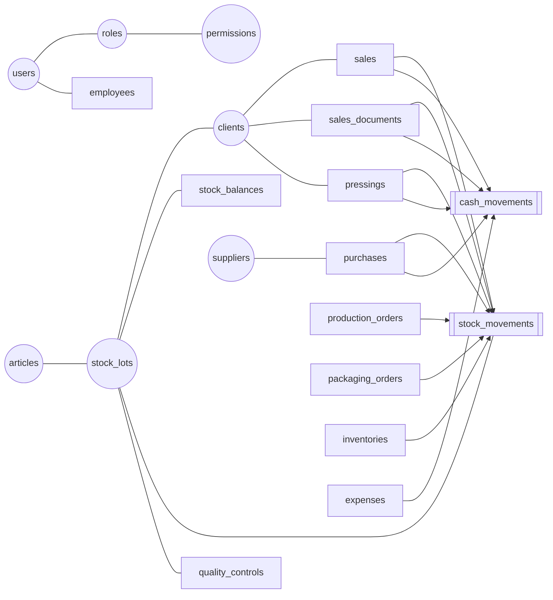

### 9.2 Security, settings and HR

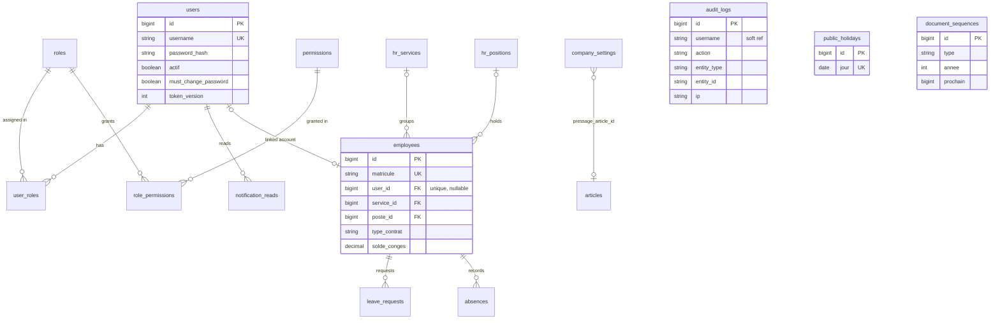

`audit_logs`, `public_holidays` and `document_sequences` have no foreign keys.

### 9.3 Catalog and stock

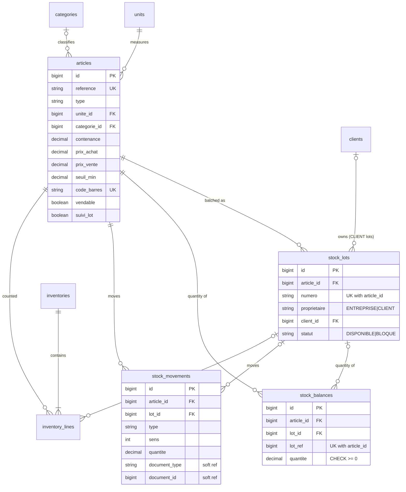

### 9.4 Sales, invoicing and finance

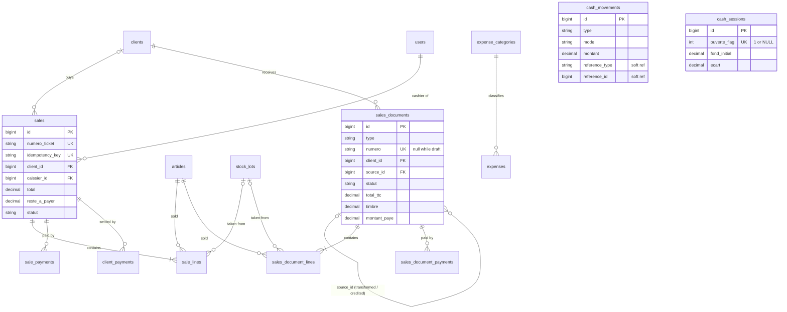

### 9.5 Purchases

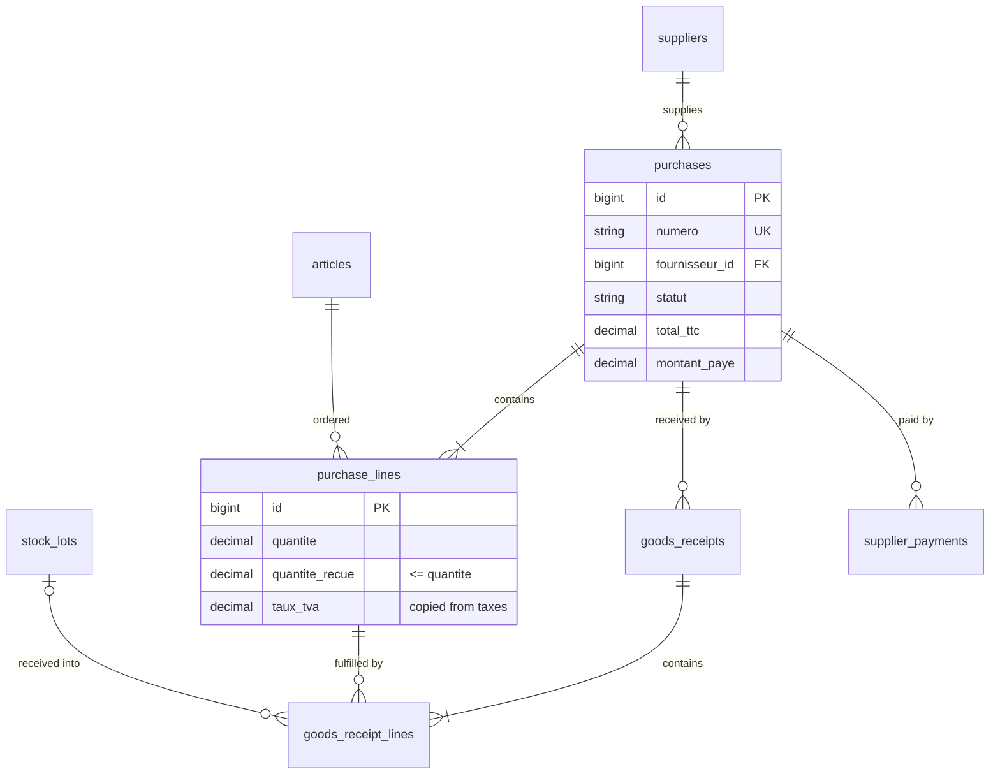

`taxes` has no foreign key: its rate is copied into `purchase_lines.taux_tva` and `sales_document_lines.taux_tva`.

### 9.6 Pressing, production and packaging

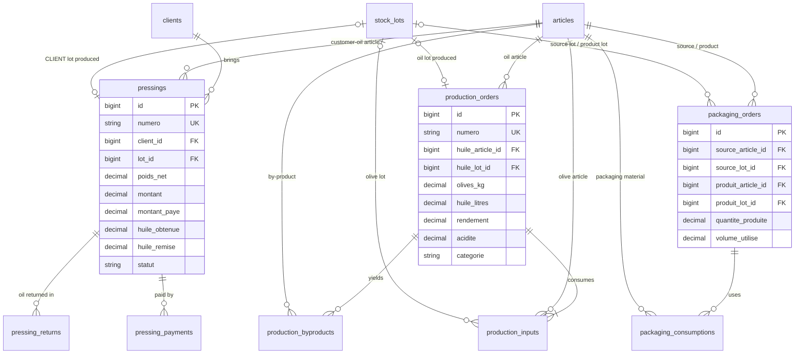

### 9.7 Quality

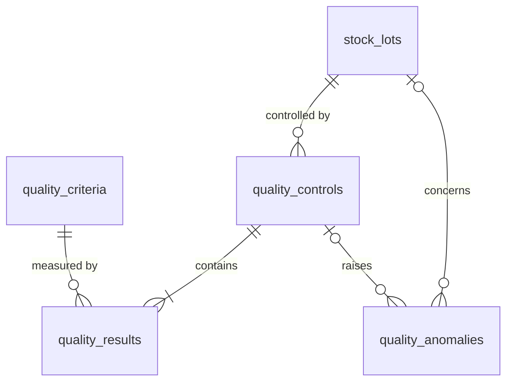

### 9.8 Important foreign-key relationships

| FK | Meaning | Delete behaviour |
|---|---|---|
| `stock_lots.client_id → clients` | Ownership of customer oil; together with `proprietaire` it is the core business safeguard | No cascade. Customers are never deleted (deactivated only). |
| `stock_balances.lot_id` / `stock_movements.lot_id → stock_lots` | Quantities per lot | No cascade. Lots have no delete endpoint. |
| `sales.caissier_id → users` | Who sold | A used user cannot be deleted (`derniere_connexion` check), and the FK would block it anyway. |
| `sales_documents.source_id → sales_documents` | Quote → order → delivery → invoice chain, and invoice ← credit note | Documents are never deleted (cancel only). |
| `goods_receipt_lines.purchase_line_id → purchase_lines` | Partial receipts | Draft lines are cleared and rebuilt by `fill()`; a draft has no receipts, so the FK is never violated. |
| `pressings.lot_id`, `production_orders.huile_lot_id`, `packaging_orders.produit_lot_id` | Lot created by the operation | Lots are never deleted. |
| `employees.user_id → users` (unique) | ERP login of an employee | Deleting an unused user linked to an employee is rejected by the FK (409 `CONTRAINTE`). |
| `company_settings.pressage_article_id → articles` | Default customer-oil article | Articles are deactivated, never deleted. |

No `ON DELETE CASCADE` exists in the schema. The application never deletes business rows, except users that were
never used, public holidays, roles, and draft lines being rebuilt.

### 9.9 Circular dependencies and redundant data

**Circular references in the data**

- `sales_documents.source_id` is a self-reference. Cycles cannot happen because a new document always points to an
  existing, older one.
- `company_settings → articles`: articles do not depend on settings, so there is no real cycle.

**Circular dependencies in the code (packages)**

- `clients.ClientService` uses `sales.SaleRepository` and `salesdocs.SalesDocumentRepository`, while `sales` and
  `salesdocs` use `clients`. This is a package-level cycle. The code works around Spring wiring with **setter
  injection** (`@Autowired void setInvoices(...)`), and does the same in `SaleService`, `DashboardService` and
  `ReportService`.
- `salesdocs.SalesDocumentService` calls the static `purchases.PurchaseService.lineHt/lineTva`, coupling sales to
  purchases.

**Redundant (derived) data, kept on purpose**

| Redundant column | Derived from | Kept consistent by |
|---|---|---|
| `stock_balances.quantite` | sum of `stock_movements` | `StockService.apply` in the same locked transaction |
| `sales.montant_paye` / `reste_a_payer` | `sale_payments` + `client_payments` | `Sale.applySettlement`, DB checks |
| `purchases.montant_paye`, `purchase_lines.quantite_recue` | `supplier_payments`, `goods_receipt_lines` | `Purchase.addPaid`, `PurchaseLine.addReceived` |
| `pressings.montant_paye`, `huile_remise` | `pressing_payments`, `pressing_returns` | `Pressing.addPayment/addReturn` |
| `sales_documents.montant_paye`, header totals | payments and lines | `SalesDocument.addPayment/totals` |
| `*_lines.designation`, `unite`, `taux_tva` | `articles`, `units`, `taxes` | Snapshot at creation, intentionally frozen |
| `production_orders.olives_kg`, `rendement`, `categorie` | inputs, oil litres, acidity | Computed in `plan`/`finish` |

No job reconciles these values. They rely entirely on all writes going through the services.

**Possibly confusing duplication**

- `users.service` (free text) and `hr_services` (table) both describe a "department".
- `users` (`prenom`, `nom`, `email`, `telephone`) and `employees` duplicate personal data when linked.

---

## 10. Main business workflows

### 10.1 POS quick sale

| Aspect | Details |
|---|---|
| Starts | The cashier opens `/ventes/rapide`. `GET /api/sales/catalog` loads the saleable articles with their saleable lots. |
| Initiator / module | `CAISSIER` (`SALES_CREATE`) / Sales. |
| Entities created | `sales`, `sale_lines`, `sale_payments`, `stock_movements` (`VENTE`), `cash_movements` (`ENCAISSEMENT`), `audit_logs`. |
| Entities updated | `stock_balances`, `document_sequences`. |
| Validations | Idempotency key, active customer, active and saleable article, lot not `CLIENT`/`BLOQUE`, price override and discount permissions, discount ≤ subtotal, non-cash payments ≤ total, credit rules, sufficient stock. |
| Result | A ticket `TCK-YYYY-NNNNNN` that can be printed. |

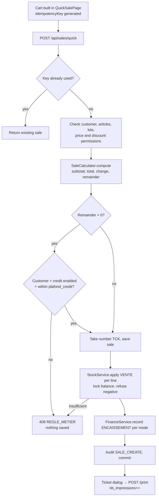

### 10.2 Customer pressing (toll service)

| Aspect | Details |
|---|---|
| Starts | A farmer arrives with olives. The pressing operator records a reception. |
| Initiator / module | `RESP_PRODUCTION` (`PRESSING_MANAGE`); the cashier can take payment / Pressing. |
| Entities created | `pressings`, a `stock_lots` row (`CLIENT`), `stock_movements` (`PRESSAGE_ENTREE`, `PRESSAGE_REMISE`), `pressing_payments`, `pressing_returns`, `cash_movements`. |
| Validations | Active customer, lot-tracked article, fee known, tare < gross, status order, payment ≤ remainder, **full payment before any return**, return ≤ oil left. |
| Result | Customer oil handed over; the pressing reaches `REMIS`. |

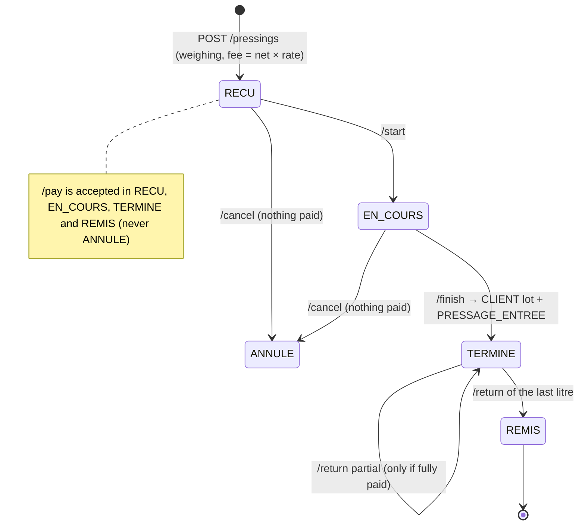

### 10.3 Purchase to stock and payment

| Aspect | Details |
|---|---|
| Starts | The purchasing manager creates a draft (`POST /api/purchases`). |
| Initiators | `RESP_ACHATS` (create, validate), `RESP_STOCK`/`RESP_ACHATS` (receive), `RESP_FINANCIER` (pay). |
| Entities | `purchases`, `purchase_lines`, `goods_receipts`, `goods_receipt_lines`, `stock_lots` (`ENTREPRISE`), `stock_movements` (`RECEPTION_ACHAT`), `supplier_payments`, `cash_movements` (`DECAISSEMENT`). |
| Result | Goods in stock in the right lot; the supplier is paid. |

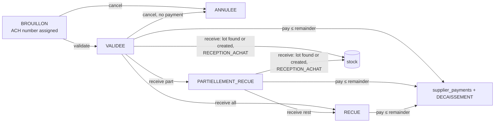

### 10.4 Crushing (production)

| Aspect | Details |
|---|---|
| Starts | The production manager plans an order (`POST /api/production`). |
| Entities | `production_orders`, `production_inputs`, `production_byproducts`, a new `stock_lots` row (oil, optionally `BLOQUE`), `stock_movements` (`CONSOMMATION_PRODUCTION`, `PRODUCTION_SORTIE`). |
| Validations | Oil article lot-tracked, inputs of type `OLIVES` from `ENTREPRISE` lots, enough olive stock at start, unique lot number, by-products not lot-tracked. |
| Result | An oil lot with yield and acidity category, possibly blocked until a quality control. |

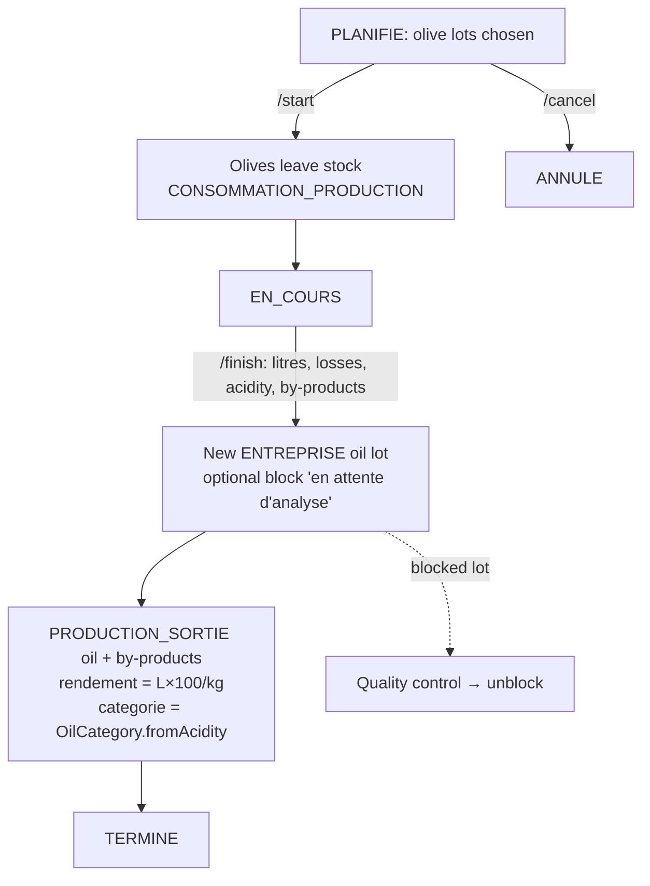

### 10.5 Packaging

`POST /api/packaging` runs in one transaction:

1. Check that the source lot is `ENTREPRISE` and not blocked, and that the product has a `contenance`.
2. Compute volume = quantity × capacity.
3. Find or create the product lot, which reuses the source lot number.
4. Apply `CONDITIONNEMENT_SORTIE` for the bulk oil and each packaging material.
5. Apply `CONDITIONNEMENT_ENTREE` for the finished goods.
6. Write the audit entry.

`POST /{id}/cancel` posts `ANNULATION_MOINS` on the finished goods (which fails if they were sold) and
`ANNULATION_PLUS` on the materials and the bulk oil.

### 10.6 Quote-to-cash (sales documents)

| Aspect | Details |
|---|---|
| Starts | The sales manager creates a quote, order, delivery note or invoice draft. |
| Initiators | `RESP_COMMERCIAL` (`SALESDOC_MANAGE` + `INVOICE_VALIDATE`), `RESP_FINANCIER` (payments). |
| Entities | `sales_documents`, lines, payments; `stock_movements` (`LIVRAISON`, `ANNULATION_PLUS`, `RETOUR_CLIENT`); `cash_movements`. |
| Result | A paid invoice, or a credit note cancelling it. |

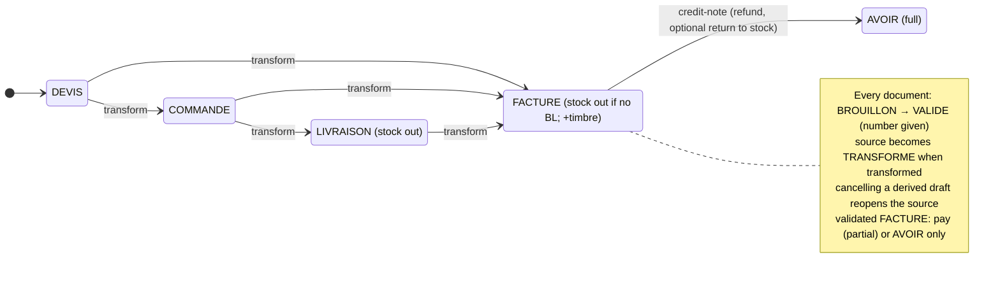

### 10.7 Quality control decision

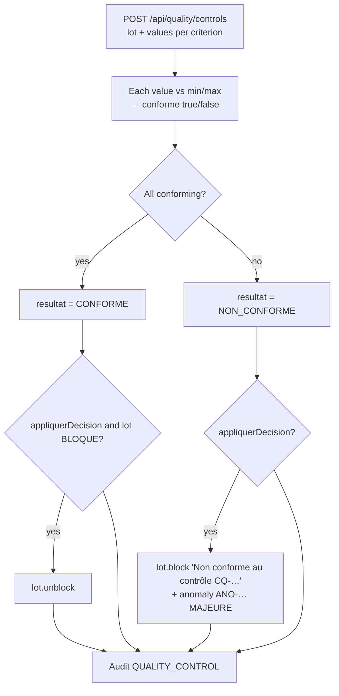

### 10.8 Physical inventory

1. **Create** (`POST /api/stock/inventories`): snapshot the theoretical quantity per article, and per lot for
   lot-tracked articles. The inventory is `EN_COURS`.
2. **Count** (`PUT /{id}/counts`): enter counted quantities, possibly several times.
3. **Validate** (`POST /{id}/validate`): for each counted line, diff = counted − *current* stock, posted as
   `INVENTAIRE_PLUS` or `INVENTAIRE_MOINS`. The inventory becomes `VALIDE`.
4. **Cancel** is possible while the inventory is `EN_COURS`. Nothing is posted.

### 10.9 Cash session

```mermaid
sequenceDiagram
    participant K as Cashier (CASH_SESSION)
    participant T as TreasuryService
    participant DB as cash_sessions / cash_movements
    K->>T: POST /finance/session/open {fondInitial}
    T->>DB: refuse if one is open; insert ouverte_flag=1
    Note over DB: during the day every module writes cash_movements
    K->>T: GET /finance/session (live theoretical cash)
    K->>T: POST /finance/session/close {especesComptees, justification}
    T->>DB: lock the open session; theoretical = float + ESPECES in − out
    alt ecart ≠ 0 and no justification
        T-->>K: 409 "la justification est obligatoire"
    else
        T->>DB: ouverte_flag = NULL, store ecart; audit CASH_CLOSE
    end
```

### 10.10 Leave request

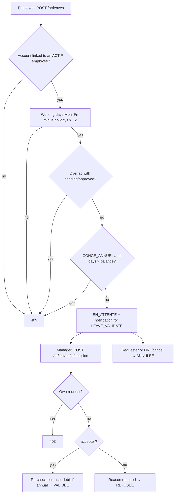

### 10.11 First start and login

1. At startup Flyway applies the migrations, and Hibernate validates the schema against the entities.
2. If `users` is empty and the bootstrap variables are set, `AdminBootstrap` creates the admin with
   `must_change_password = true` and audits `ADMIN_BOOTSTRAP`.
3. `POST /api/auth/login` returns a JWT plus the profile. The SPA stores the token and, because
   `mustChangePassword` is set, redirects to `/profil`.
4. `POST /api/auth/change-password` increments `token_version` and returns a new token. Every module is now
   reachable according to the user's roles.

---

## 11. Module interactions

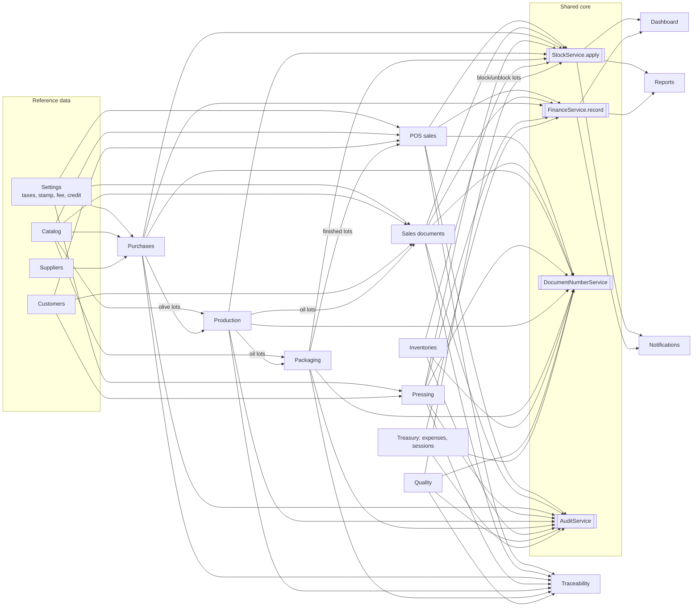

### 11.1 Data produced by one module and consumed by another

| Producer | Data | Consumers |
|---|---|---|
| Purchases | `ENTREPRISE` olive and goods lots, `RECEPTION_ACHAT` | Production (olive inputs), Stock, Traceability, Reports, Finance (payables) |
| Production | Oil lot (optionally blocked), by-products | Quality (control/unblock), Packaging (source), Sales documents and POS (sale), Traceability, Reports |
| Packaging | Finished-goods lot | POS (catalog), Sales documents, Traceability |
| Pressing | `CLIENT` lot | Stock (shown as "clients" quantity), Traceability, Dashboard (oil to return) |
| Quality | Lot status | POS (refuses blocked lots), Sales documents (`isSellable`), Packaging (refuses blocked source), Stock state (blocked quantity), Notifications |
| POS & Sales documents | Outstanding balances | Customers (`solde`), credit-limit checks, Dashboard, Reports, Notifications (overdue invoices) |
| All money operations | `cash_movements` | Cash sessions (theoretical cash), cash journal, Dashboard, finance report |
| Settings | Credit switch, fee, stamp, idle delay, header | POS, Pressing, Sales documents, MainLayout, print dialogs |
| HR | Pending leave, ending contracts | Dashboard, Notifications |

### 11.2 Modification and deletion effects

- **Master data is never physically deleted.** Articles, customers, suppliers, units, categories, taxes, expense
  categories and quality criteria use an `actif` flag. Inactive items are refused in **new** documents but stay
  valid on old ones, because lines hold copies (`designation`, `unite`, `taux_tva`).
- **Editing an article** changes nothing in past lines. Its `suivi_lot` flag is frozen.
- **Editing a tax rate** does not affect existing lines, which keep the copied rate.
- **Changing a role's permissions** applies on the next request for every holder.
- **Changing or deactivating a user** bumps `token_version`, which logs the user out everywhere.
- **Validated transactions are never edited.** They are cancelled with compensating movements: sale cancellation,
  packaging cancellation, delivery-note cancellation, credit note, expense reversal.
- **Any delete that a foreign key protects** returns 409 `CONTRAINTE` through `GlobalExceptionHandler`.

### 11.3 Automatic calculations and status changes

| Trigger | Automatic effect |
|---|---|
| Any stock movement | `stock_balances` updated; low-stock state recomputed when read |
| Purchase receipt | Line `quantite_recue`, status `PARTIELLEMENT_RECUE`/`RECUE`, lot creation |
| Pressing finish / return | `CLIENT` lot creation; `REMIS` when everything is returned |
| Production finish | Yield, oil category, optional lot block |
| Quality control + decision | Lot blocked + anomaly, or lot unblocked |
| Transformation | Source `TRANSFORME`; cancelling the derived draft sets the source back to `VALIDE` |
| Credit note | Invoice `ANNULE`, refund `DECAISSEMENT`, optional `RETOUR_CLIENT` |
| Invoice validation | Fiscal stamp added, number assigned, credit limit checked, stock out if needed |
| Leave approval | `solde_conges` debited (annual leave) |
| Password change / reset / role change / deactivation | `token_version` incremented |
| Login | `derniere_connexion` set (and the user can no longer be deleted) |

---

## 12. API inventory

**Conventions that apply to every endpoint:**

- Base path `/api`, JSON only.
- Authentication: `Authorization: Bearer <JWT>` on everything except `POST /api/auth/login` and
  `GET /actuator/health`.
- Authorization is enforced by `@PreAuthorize` on the **service** method; the "Permission" column below reproduces
  it.
- Lists return `PageResponse{content, page, size, totalElements, totalPages}`. `size` is capped at 100 (200 for
  audit).
- Errors return `ApiError`: 400 `VALIDATION` with `fieldErrors`, 400 `REQUETE_INVALIDE`, 401 `NON_AUTHENTIFIE`,
  403 `ACCES_REFUSE`, 404 `INTROUVABLE`, 409 `REGLE_METIER` / `CONTRAINTE` / `OCCUPE`, 500 `ERREUR_INTERNE`.
- Creation endpoints return **201**, except `POST /sales/quick`, which returns 200 on purpose because a replay
  returns the existing sale.

### 12.1 Auth, users, roles, audit

| Method | URL | Purpose | Body / params | Response | Controller → Service | Permission |
|---|---|---|---|---|---|---|
| POST | `/api/auth/login` | Log in | `LoginRequest{username, password, rememberMe}` | `LoginResponse{token, expiresIn, user}` | `AuthController` → `AuthService.login` | public |
| GET | `/api/auth/me` | Current profile | — | `MeResponse` | `AuthService.me` | authenticated |
| POST | `/api/auth/change-password` | Change password, get new token | `{currentPassword, newPassword}` | `LoginResponse` | `AuthService.changePassword` | authenticated (also during forced change) |
| GET | `/api/users` | List users | — | `UserResponse[]` | `UserController` → `UserService.listUsers` | `USER_MANAGE` |
| GET | `/api/users/{id}` | One user | — | `UserResponse` | `UserService.get` | `USER_MANAGE` (unused by UI) |
| POST | `/api/users` | Create user | `CreateUserRequest` | `UserResponse` | `UserService.createUser` | `USER_MANAGE` (+`ADMIN` role to grant `ADMIN`) |
| PUT | `/api/users/{id}` | Update profile and roles | `UpdateUserRequest` | `UserResponse` | `UserService.update` | `USER_MANAGE` (+`ADMIN` for admins) |
| PATCH | `/api/users/{id}/status` | Activate / deactivate | `{active}` | `UserResponse` | `UserService.updateStatus` | `USER_MANAGE` |
| POST | `/api/users/{id}/reset-password` | Temporary password | `{temporaryPassword}` | `UserResponse` | `UserService.resetPassword` | `USER_MANAGE` |
| DELETE | `/api/users/{id}` | Delete a never-used account | — | 204 | `UserService.delete` | `USER_MANAGE` |
| GET | `/api/roles` | List roles | — | `RoleResponse[]` | `UserController` → `UserService.listRoles` | `USER_MANAGE` |
| GET | `/api/permissions` | List permissions | — | `PermissionResponse[]` | `RoleController` → `RoleService.listPermissions` | `ROLE_MANAGE` or `USER_MANAGE` |
| POST | `/api/roles` | Create role | `RoleRequest{code, name, description, permissions}` | `RoleResponse` | `RoleService.create` | `ROLE_MANAGE` |
| PUT | `/api/roles/{id}` | Update role | `RoleRequest` | `RoleResponse` | `RoleService.update` | `ROLE_MANAGE` |
| DELETE | `/api/roles/{id}` | Delete custom role | — | 204 | `RoleService.delete` | `ROLE_MANAGE` |
| GET | `/api/audit` | Search audit log | `username, action, entity, from, to, page, size` | `PageResponse<Line>` | `AuditController` → `AuditLogRepository` | `AUDIT_VIEW` |
| GET | `/actuator/health` | Liveness | — | `{status}` | Actuator | public |

### 12.2 Settings, catalog, customers, suppliers

| Method | URL | Purpose | Body / params | Service | Permission |
|---|---|---|---|---|---|
| GET | `/api/settings` | Company settings | — | `SettingsService.get` | authenticated |
| PUT | `/api/settings` | Update settings | `SettingsRequest` | `SettingsService.update` | `SETTINGS_MANAGE` |
| GET / POST / PUT / PATCH | `/api/settings/taxes`, `/{id}`, `/{id}/status` | VAT rates | `TaxRequest{nom, taux}`, `{actif}` | `ReferenceService` | GET authenticated, writes `SETTINGS_MANAGE` |
| GET / POST / PUT / PATCH | `/api/settings/expense-categories`, `/{id}`, `/{id}/status` | Expense categories | `{nom}`, `{actif}` | `ReferenceService` | GET authenticated, writes `SETTINGS_MANAGE` or `FINANCE_MANAGE` |
| GET / POST / PUT / PATCH | `/api/catalog/units`, `/{id}`, `/{id}/status` | Units | `UnitDto.Request{code, libelle}` | `CatalogService` | GET authenticated, writes `CATALOG_MANAGE` |
| GET / POST / PUT / PATCH | `/api/catalog/categories`, `/{id}`, `/{id}/status` | Categories | `CategoryDto.Request` | `CatalogService` | GET authenticated, writes `CATALOG_MANAGE` |
| GET | `/api/catalog/articles` | Search articles | `q, type, categoryId, actif, page, size` | `CatalogService.searchArticles` | `CATALOG_VIEW` |
| GET | `/api/catalog/articles/{id}` | One article | — | `CatalogService.getArticle` | `CATALOG_VIEW` (unused by UI) |
| POST / PUT | `/api/catalog/articles`, `/{id}` | Save article | `ArticleDto.Request` | `CatalogService.saveArticle` | `CATALOG_MANAGE` |
| PATCH | `/api/catalog/articles/{id}/status` | (De)activate | `{actif}` | `CatalogService.setArticleStatus` | `CATALOG_MANAGE` |
| GET | `/api/clients` | Search customers (with balance) | `q, type, actif, page, size` | `ClientService.search` | `CLIENT_VIEW` |
| GET | `/api/clients/{id}` | One customer | — | `ClientService.get` | `CLIENT_VIEW` (unused by UI) |
| POST / PUT | `/api/clients`, `/{id}` | Save customer | `ClientDto.Request` | `ClientService.save` | `CLIENT_MANAGE` |
| PATCH | `/api/clients/{id}/status` | (De)activate | `{actif}` | `ClientService.setStatus` | `CLIENT_MANAGE` |
| GET | `/api/suppliers`, `/{id}` | Search / one supplier | `q, type, actif, page, size` | `SupplierService` | `SUPPLIER_VIEW` (`/{id}` unused by UI) |
| POST / PUT / PATCH | `/api/suppliers`, `/{id}`, `/{id}/status` | Save / (de)activate | `SupplierDto.Request`, `{actif}` | `SupplierService` | `SUPPLIER_MANAGE` |

### 12.3 Stock, inventories, traceability

| Method | URL | Purpose | Body / params | Service | Permission |
|---|---|---|---|---|---|
| GET | `/api/stock/state` | Stock per article (available / blocked / customers, lots, alert) | `q, type, alertOnly, page, size` | `StockService.stockState` | `STOCK_VIEW` |
| GET | `/api/stock/movements` | Movement journal | `articleId, lotId, type, from, to, page, size` | `StockService.searchMovements` | `STOCK_VIEW` |
| POST | `/api/stock/movements` | Manual movement | `MovementRequest{articleId, lotId, type, quantite, motif}` | `StockService.manualMovement` | `STOCK_ADJUST` |
| GET | `/api/stock/lots` | Lots with quantity | `q, articleId, owner, statut, page, size` | `StockService.searchLots` | `STOCK_VIEW` |
| POST | `/api/stock/lots` | Create lot | `LotRequest{articleId, numero, proprietaire, clientId}` | `StockService.createLot` | `STOCK_ADJUST` |
| PATCH | `/api/stock/lots/{id}/status` | Block / unblock | `{statut, motif}` | `StockService.setLotStatus` | `STOCK_ADJUST` |
| GET | `/api/stock/inventories`, `/{id}` | List / detail | `page, size` | `InventoryService` | `STOCK_VIEW` |
| POST | `/api/stock/inventories` | Create (snapshot) | `{libelle, articleIds}` | `InventoryService.create` | `STOCK_ADJUST` |
| PUT | `/api/stock/inventories/{id}/counts` | Enter counts | `{lignes:[{lineId, quantiteComptee}]}` | `InventoryService.count` | `STOCK_ADJUST` |
| POST | `/api/stock/inventories/{id}/validate`, `/cancel` | Validate / cancel | — | `InventoryService` | `STOCK_ADJUST` |
| GET | `/api/traceability/lots/{id}` | Upstream / downstream trace | — | `TraceabilityService.trace` | `STOCK_VIEW` or `PRODUCTION_VIEW` |

### 12.4 POS sales and receivables

| Method | URL | Purpose | Body / params | Service | Permission |
|---|---|---|---|---|---|
| GET | `/api/sales/catalog` | Saleable articles with saleable lots | — | `SaleService.sellableCatalog` | `SALES_CREATE` |
| POST | `/api/sales/quick` | Create sale (idempotent) | `QuickSaleRequest` | `SaleService.createQuickSale` | `SALES_CREATE` (+`SALES_DISCOUNT`, `SALES_PRICE_OVERRIDE` when used) |
| GET | `/api/sales` | Ticket history | `from, to, numero, clientId, cashierId, statut, page, size` | `SaleService.search` | `SALES_VIEW` |
| GET | `/api/sales/{id}` | Detail with settlements | — | `SaleService.get` | `SALES_VIEW` |
| GET | `/api/sales/cashiers` | Cashier filter list | — | `SaleService.cashiers` | `SALES_VIEW` |
| POST | `/api/sales/{id}/print` | Record a print / reprint | — | `SaleService.recordPrint` | `SALES_VIEW` |
| POST | `/api/sales/{id}/cancel` | Cancel with compensation | `{motif}` | `SaleService.cancel` | `SALES_CANCEL` |
| GET | `/api/sales/receivables` | Receivables per customer | — | `SaleService.receivables` | `SALES_VIEW` or `FINANCE_VIEW` |
| GET | `/api/sales/receivables/{clientId}` | Open credit sales | — | `SaleService.openCredits` | `SALES_VIEW` or `FINANCE_VIEW` |
| POST | `/api/sales/{id}/settle` | Pay a credit sale | `{mode, montant, reference}` | `SaleService.settle` | `SALES_CREATE` or `FINANCE_MANAGE` |

### 12.5 Sales documents

| Method | URL | Purpose | Body / params | Service | Permission |
|---|---|---|---|---|---|
| GET | `/api/sales-documents` | List by type (**`type` is required**) | `type, q, statut, clientId, from, to, unpaid, page, size` | `SalesDocumentService.search` | `SALES_VIEW` |
| GET | `/api/sales-documents/{id}` | Detail + related | — | `get` | `SALES_VIEW` |
| POST / PUT | `/api/sales-documents`, `/{id}` | Save draft | `SalesDocDto.Request` | `create` / `update` | `SALESDOC_MANAGE` |
| POST | `/{id}/validate` | Validate (number, stamp, stock) | — | `validate` | `SALESDOC_MANAGE` (+`INVOICE_VALIDATE` for invoices) |
| POST | `/{id}/transform` | Transform | `{cible}` | `transform` | `SALESDOC_MANAGE` |
| POST | `/{id}/pay` | Pay an invoice | `{mode, montant, reference}` | `pay` | `SALESDOC_MANAGE` or `FINANCE_MANAGE` |
| POST | `/{id}/credit-note` | Full credit note | `{motif, retourStock, modeRemboursement}` | `creditNote` | `INVOICE_VALIDATE` |
| POST | `/{id}/cancel` | Cancel | `{motif}` | `cancel` | `SALESDOC_MANAGE` |

### 12.6 Purchases

| Method | URL | Purpose | Body / params | Service | Permission |
|---|---|---|---|---|---|
| GET | `/api/purchases` | Search | `q, supplierId, statut, from, to, unpaid, page, size` | `PurchaseService.search` | `PURCHASE_VIEW` |
| GET | `/api/purchases/{id}` | Detail with receipts and payments | — | `get` | `PURCHASE_VIEW` |
| GET | `/api/purchases/payables` | Payables per supplier | — | `payables` | `PURCHASE_VIEW` or `FINANCE_VIEW` |
| POST / PUT | `/api/purchases`, `/{id}` | Save draft | `PurchaseDto.Request` | `create` / `update` | `PURCHASE_CREATE` |
| POST | `/{id}/validate`, `/{id}/cancel` | Validate / cancel | `{motif}` for cancel | `validate` / `cancel` | `PURCHASE_VALIDATE` |
| PATCH | `/{id}/invoice-ref` | Supplier invoice reference | `{refFacture}` | `setInvoiceRef` | `PURCHASE_CREATE` or `FINANCE_MANAGE` (**unused by UI**) |
| POST | `/{id}/receive` | Receive goods | `ReceiveRequest` | `receive` | `PURCHASE_RECEIVE` |
| POST | `/{id}/pay` | Pay supplier | `{mode, montant, reference}` | `pay` | `FINANCE_MANAGE` |

### 12.7 Pressing, production, packaging

| Method | URL | Purpose | Service | Permission |
|---|---|---|---|---|
| GET | `/api/pressings`, `/{id}` | Search (`q, statut, clientId, from, to`) / detail | `PressingService` | `PRESSING_VIEW` |
| POST | `/api/pressings` | Reception and weighing (`ReceiveRequest`) | `receive` | `PRESSING_MANAGE` |
| POST | `/{id}/start`, `/{id}/finish`, `/{id}/return`, `/{id}/cancel` | Lifecycle | `start` / `finish` / `returnOil` / `cancel` | `PRESSING_MANAGE` |
| POST | `/{id}/pay` | Collect fee | `pay` | `PRESSING_MANAGE` or `SALES_CREATE` |
| GET | `/api/production`, `/{id}` | Search (`q, statut, from, to`) / detail | `ProductionService` | `PRODUCTION_VIEW` |
| POST / PUT | `/api/production`, `/{id}` | Plan / update (`PlanRequest`) | `plan` | `PRODUCTION_MANAGE` |
| POST | `/{id}/start`, `/{id}/finish`, `/{id}/cancel` | Lifecycle | `start` / `finish` / `cancel` | `PRODUCTION_MANAGE` |
| GET | `/api/packaging` | Search (`q, statut, from, to`) | `PackagingService.search` | `PACKAGING_VIEW` |
| POST | `/api/packaging`, `/{id}/cancel` | Create / cancel | `create` / `cancel` | `PACKAGING_MANAGE` |

### 12.8 Quality, HR, finance

| Method | URL | Purpose | Service | Permission |
|---|---|---|---|---|
| GET | `/api/quality/criteria` | Criteria | `QualityService.listCriteria` | `QUALITY_VIEW` |
| POST / PUT / PATCH | `/api/quality/criteria`, `/{id}`, `/{id}/status` | Save / (de)activate | `saveCriterion`, `setCriterionStatus` | `QUALITY_MANAGE` |
| GET / POST | `/api/quality/controls` | Search (`q, resultat, lotId`) / record | `searchControls` / `record` | `QUALITY_VIEW` / `QUALITY_MANAGE` |
| GET / POST / PUT | `/api/quality/anomalies`, `/{id}` | Search (`statut, gravite`) / create / update | `searchAnomalies`, `createAnomaly`, `updateAnomaly` | `QUALITY_VIEW` / `QUALITY_MANAGE` |
| GET / POST / PUT | `/api/hr/services`, `/api/hr/positions`, `/{id}` | Departments / positions | `HrService.listServices/listPositions/saveRef` | `HR_VIEW` / `HR_MANAGE` |
| GET / POST / PUT | `/api/hr/employees`, `/{id}` | Search (`q, serviceId, statut, contrat`) / save | `searchEmployees`, `saveEmployee` | `HR_VIEW` / `HR_MANAGE` |
| GET | `/api/hr/me` | Own employee file | `me` | `LEAVE_REQUEST` |
| GET | `/api/hr/leaves` | Leave list (`employeeId, statut, mine`) | `searchLeaves` | `LEAVE_REQUEST` or `HR_VIEW` (own only without `HR_VIEW`/`LEAVE_VALIDATE`) |
| POST | `/api/hr/leaves` | Request leave | `requestLeave` | `LEAVE_REQUEST` or `HR_MANAGE` |
| POST | `/api/hr/leaves/{id}/decision` | Approve / reject | `decide` | `LEAVE_VALIDATE` |
| POST | `/api/hr/leaves/{id}/cancel` | Cancel pending leave | `cancelLeave` | `LEAVE_REQUEST` or `HR_MANAGE` (own unless HR) |
| GET | `/api/hr/leaves/working-days` | Working days between `from`–`to` | `workingDays` | authenticated (**no `@PreAuthorize`**; harmless) |
| GET / POST | `/api/hr/absences` | Search / record | `searchAbsences` / `recordAbsence` | `HR_VIEW` / `HR_MANAGE` |
| GET / POST / DELETE | `/api/hr/holidays`, `/{id}` | Public holidays | `listHolidays`, `addHoliday`, `deleteHoliday` | authenticated / `HR_MANAGE` |
| GET | `/api/finance/cash` | Cash journal + totals (`from, to, type, mode`) | `FinanceService.journal` | `FINANCE_VIEW` |
| GET / POST | `/api/finance/expenses`, `/{id}/cancel` | Search / create / cancel expense | `TreasuryService` | `FINANCE_VIEW` / `FINANCE_MANAGE` |
| GET | `/api/finance/session` | Open session (204 if none) | `TreasuryService.current` | `CASH_SESSION` or `FINANCE_VIEW` |
| GET | `/api/finance/sessions` | Session history | `history` | `CASH_SESSION` or `FINANCE_VIEW` |
| POST | `/api/finance/session/open`, `/close` | Open / close | `open` / `close` | `CASH_SESSION` |

### 12.9 Dashboard, reports, notifications, search

| Method | URL | Purpose | Service | Permission |
|---|---|---|---|---|
| GET | `/api/dashboard` | KPI blocks (null when not allowed) | `DashboardService.build` | `DASHBOARD_VIEW` (+ per block) |
| GET | `/api/reports/sales?from&to` | Sales report (POS tickets) | `ReportService.sales` | `REPORT_VIEW` |
| GET | `/api/reports/purchases?from&to` | Purchases per supplier | `purchases` | `REPORT_VIEW` |
| GET | `/api/reports/stock` | Valued stock | `stock` | `REPORT_VIEW` |
| GET | `/api/reports/finance?from&to` | Cash by mode, expenses | `finance` | `REPORT_VIEW` |
| GET | `/api/reports/production?from&to` | Crushing, pressing, bottling | `production` | `REPORT_VIEW` |
| GET | `/api/notifications` | Computed alerts | `NotificationService.list` | authenticated (+ per block) |
| POST | `/api/notifications/read` | Mark keys as read (`{keys}`) | `markRead` | authenticated |
| GET | `/api/search?q=` | Global search (≥ 2 characters) | `SearchService.search` | authenticated (+ per section) |

### 12.10 Unused, duplicated, incomplete or problematic APIs

| Endpoint | Observation |
|---|---|
| `PATCH /api/purchases/{id}/invoice-ref` | Implemented and audited, but **no frontend call**. The reference can only be set while the purchase is a draft. |
| `GET /api/clients/{id}`, `/api/suppliers/{id}`, `/api/catalog/articles/{id}`, `/api/users/{id}` | Implemented, **not used** by the SPA (lists carry all fields). |
| `GET /api/roles` | Lives in `UserController` and requires `USER_MANAGE`, while the Roles page is open to `ROLE_MANAGE`. **Inconsistent** (§15.1). |
| `GET /api/hr/leaves/working-days` | The only business endpoint with no `@PreAuthorize`. It is still behind authentication and exposes only holiday-derived counts. |
| `GET /api/sales-documents` | `type` is mandatory. Spring raises `MissingServletRequestParameterException` when it is missing. `GlobalExceptionHandler` has no specific handler for it, so the catch-all `Exception` handler probably turns it into a **500** instead of a 400. This was **not verified at runtime**. |
| `/api/audit` | The controller calls the repository directly, with no service layer. This is a minor deviation from the architecture rule. |
| Duplicated maths | `PurchaseService.lineHt/lineTva` is reused by sales documents; the POS has its own `SaleCalculator`. This is consistent but scattered. |
| No OpenAPI / Swagger | There is no machine-readable API contract (acknowledged in `docs/conformite-cdc.md` §32). |

---

## 13. User roles and permissions

### 13.1 Permission catalog (40)

| Group | Permissions |
|---|---|
| Administration | `USER_MANAGE`, `ROLE_MANAGE`, `AUDIT_VIEW`, `SETTINGS_MANAGE` |
| Overview | `DASHBOARD_VIEW`, `REPORT_VIEW` |
| Partners and catalog | `CLIENT_VIEW`, `CLIENT_MANAGE`, `SUPPLIER_VIEW`, `SUPPLIER_MANAGE`, `CATALOG_VIEW`, `CATALOG_MANAGE` |
| Purchases | `PURCHASE_VIEW`, `PURCHASE_CREATE`, `PURCHASE_VALIDATE`, `PURCHASE_RECEIVE` |
| Operations | `PRODUCTION_VIEW`, `PRODUCTION_MANAGE`, `PRESSING_VIEW`, `PRESSING_MANAGE`, `PACKAGING_VIEW`, `PACKAGING_MANAGE` |
| Stock and quality | `STOCK_VIEW`, `STOCK_ADJUST`, `QUALITY_VIEW`, `QUALITY_MANAGE` |
| Sales | `SALES_VIEW`, `SALES_CREATE`, `SALES_CANCEL`, `SALES_PRICE_OVERRIDE`, `SALES_DISCOUNT`, `SALESDOC_MANAGE`, `INVOICE_VALIDATE` |
| Finance | `FINANCE_VIEW`, `FINANCE_MANAGE`, `CASH_SESSION` |
| HR | `HR_VIEW`, `HR_MANAGE`, `LEAVE_REQUEST`, `LEAVE_VALIDATE` |

### 13.2 Effective role matrix (after migrations V2 + V6 + V7 + V8)

`●` = granted. `ADMIN` has all 40 permissions.

| Permission | CAISSIER | RESP_STOCK | RESP_PRODUCTION | RESP_ACHATS | RESP_FINANCIER | RESP_COMMERCIAL | RESP_QUALITE | RESP_RH | EMPLOYE |
|---|:-:|:-:|:-:|:-:|:-:|:-:|:-:|:-:|:-:|
| DASHBOARD_VIEW | ● | ● | ● | ● | ● | ● | ● | ● | ● |
| LEAVE_REQUEST | ● | ● | ● | ● | ● | ● | ● | ● | ● |
| CLIENT_VIEW | ● | | | | ● | ● | | | |
| CLIENT_MANAGE | | | | | | ● | | | |
| SUPPLIER_VIEW | | | | ● | ● | | | | |
| SUPPLIER_MANAGE | | | | ● | | | | | |
| CATALOG_VIEW | ● | ● | ● | ● | | ● | | | |
| CATALOG_MANAGE | | ● | | | | | | | |
| STOCK_VIEW | | ● | ● | ● | | ● | ● | | |
| STOCK_ADJUST | | ● | | | | | ● | | |
| PURCHASE_VIEW | | ● | | ● | ● | | | | |
| PURCHASE_CREATE | | | | ● | | | | | |
| PURCHASE_VALIDATE | | | | ● | | | | | |
| PURCHASE_RECEIVE | | ● | | ● | | | | | |
| PRODUCTION_VIEW / _MANAGE | | | ● / ● | | | | ● / – | | |
| PRESSING_VIEW / _MANAGE | ● / – | | ● / ● | | | | | | |
| PACKAGING_VIEW / _MANAGE | | ● / – | ● / ● | | | | | | |
| QUALITY_VIEW / _MANAGE | | | ● / ● | | | | ● / ● | | |
| SALES_VIEW | ● | | | | ● | ● | | | |
| SALES_CREATE | ● | | | | | | | | |
| SALES_CANCEL / PRICE_OVERRIDE / DISCOUNT | | | | | | | | | |
| SALESDOC_MANAGE | | | | | ● | ● | | | |
| INVOICE_VALIDATE | | | | | ● | ● | | | |
| FINANCE_VIEW | | | | ● | ● | | | | |
| FINANCE_MANAGE | | | | | ● | | | | |
| CASH_SESSION | ● | | | | | | | | |
| REPORT_VIEW | | ● | ● | ● | ● | ● | ● | | |
| AUDIT_VIEW | | | | | ● | | | | |
| HR_VIEW / HR_MANAGE / LEAVE_VALIDATE | | | | | | | | ● / ● / ● | |
| USER_MANAGE, ROLE_MANAGE, SETTINGS_MANAGE | | | | | | | | | |

`SALES_CANCEL`, `SALES_PRICE_OVERRIDE`, `SALES_DISCOUNT`, `USER_MANAGE`, `ROLE_MANAGE` and `SETTINGS_MANAGE` are
held by `ADMIN` only, by default.

### 13.3 Enforcement model

- **Backend**: `@PreAuthorize` on service methods, plus explicit checks inside methods. Examples:
  `SecurityUtils.has("SALES_DISCOUNT")`, `INVOICE_VALIDATE` checked inside `validate`, admin-only rules in
  `UserService`, and "cannot approve your own leave" in `HrService.decide`.
- **Frontend**: `RequirePermission` on routes, `NAVIGATION[].permission` on menu items, and `can()` on buttons and
  tabs. Code comments say explicitly that this is cosmetic.
- **Special rules**:
  - A temporary password leaves the user with no permissions.
  - Only an admin can grant `ADMIN` or modify an admin.
  - The last active admin cannot be removed.
  - The `ADMIN` role cannot be edited.

---

## 14. Implementation status

| Module | Status | Implemented | Partial / missing (verified in code or stated in `docs/`) |
|---|---|---|---|
| Authentication | ✅ Complete | JWT, revocation, forced password change, remember-me, idle logout (client) | ⬜ login rate limiting / lockout; ⬜ e-mail reset |
| Users | ✅ | Full CRUD with safeguards | — |
| Roles & permissions | ✅ | Matrix, custom roles | 🟡 `GET /roles` permission mismatch |
| Audit | ✅ | All modules write; IP; viewer | ⬜ old/new values; 🟡 some actions not audited (tax/category/criterion toggles, holidays, leave cancellation, HR references) |
| Settings | ✅ | Company, taxes, expense categories, pressing, stamp, idle delay | Fixed currency |
| Catalog | ✅ | Articles, units, categories | — |
| Customers | ✅ | CRUD, balance, credit limit | 🟡 no history tab |
| Suppliers | ✅ | CRUD, bank details | — |
| Stock | ✅ | Journal, projection, lots, blocks, inventories | ⬜ multi-warehouse and transfers |
| POS | ✅ | Sale, mixed payment, credit, print, cancel, settlements | 🟡 credit-limit check ignores invoice balance |
| Sales documents | ✅ | Full cycle, stamp, payments, credit note, A4 print, amount in words | ⬜ partial credit note; 🟡 inactive taxes accepted |
| Purchases | ✅ | Draft → validate → partial receipts → payments | ⬜ purchase request, supplier return; 🟡 `prix_achat` not updated; unused invoice-ref endpoint |
| Pressing | ✅ | Full lifecycle, slips | ⬜ payment by share of oil |
| Production | 🟡 Mostly | Plan, start, finish, yield, category, by-products | ⬜ reversal of a started order; ⬜ mass balance; ⬜ olive waiting-time alert; 🟡 blocked olive lots not refused |
| Packaging | ✅ | Atomic, cancel by reversal | — |
| Traceability | 🟡 Partial | Purchases, pressing, crushing, packaging, POS, returns | ⬜ sales documents and quality controls missing |
| Quality | ✅ | Criteria, controls, auto block/unblock, anomalies | 🟡 unblocks regardless of block origin |
| Finance | ✅ | Journal, sessions, expenses, receivables, payables | ⬜ separate bank accounts |
| HR | 🟡 Mostly | Employees, contracts, leave workflow, absences, holidays | ⬜ leave accrual; ⬜ cancelling approved leave; ⬜ deactivating departments/positions |
| Dashboard | ✅ | Permission-filtered KPIs | 🟡 "invoiced this month" includes cancelled invoices |
| Reports | ✅ | 5 reports, CSV, print | 🟡 sales report = POS only; ⬜ user-activity report |
| Notifications | ✅ | In-app computed alerts, read state | ⬜ e-mail / SMS / WhatsApp |
| Search | ✅ | 10 entity types | Links go to the module, not the record |
| Tests | 🟡 | 80 backend tests (auth, permissions, migrations, every service) | No frontend tests. The tests **were not executed** for this analysis. |
| Docs / deliverables | 🟡 | README, `docs/*` | ⬜ user manual, ⬜ OpenAPI; several stale docs (§15.4) |

Dead or placeholder code: `frontend/src/pages/ModulePlaceholder.jsx` and `MODULES` in `utils/navigation.js` are no
longer used by any route. The `package-info.java` files in `catalog`, `clients`, `inventory`, `sales`, `finance`
and others still say "Volontairement vide à l'étape 1" although the modules are implemented.

---

## 15. Technical observations and potential improvements

### 15.1 Frontend vs backend discrepancies

| # | Discrepancy | Evidence | Impact |
|---|---|---|---|
| 1 | The Roles page (`/roles`) is allowed for `ROLE_MANAGE` or `USER_MANAGE`, but it loads `GET /api/roles`, which needs **`USER_MANAGE`**. | `AppRoutes.jsx`, `RolesPage.jsx:34`, `UserService.listRoles` | A custom role holding only `ROLE_MANAGE` gets a 403 and cannot use the page. (`ADMIN` has both, so the default setup works.) |
| 2 | The pressing reception modal lists customers through `GET /api/clients` (`CLIENT_VIEW`). **`RESP_PRODUCTION` lacks `CLIENT_VIEW`** although it holds `PRESSING_MANAGE`. | `ReceptionModal.jsx`, migrations V2/V7/V8 | The production manager cannot pick a customer, so cannot register a pressing unless the role is extended. |
| 3 | The HR employee form loads `GET /api/users` (`USER_MANAGE`) to link a login. `RESP_RH` lacks it, and the error is swallowed (`.catch(() => [])`). | `HrPage.jsx:28` | The HR manager cannot link employees to accounts, so "my leave" does not work for those employees. |
| 4 | `RESP_FINANCIER` has `SALESDOC_MANAGE` + `INVOICE_VALIDATE` but **no `CATALOG_VIEW` / `STOCK_VIEW`**, which the document form uses to pick articles and lots. | `SalesDocFormModal.jsx`, V8 | The finance manager can validate and pay, but cannot properly build a document. |
| 5 | `utils/roles.js` `ROLE_LABELS` lacks the V8 roles (`RESP_COMMERCIAL`, `RESP_QUALITE`, `RESP_RH`, `EMPLOYE`). | `utils/roles.js` | Raw codes are displayed for those roles. |
| 6 | Tickets and A4 documents reference `logo/logo.png`, which is **not in the repository** (only SVGs exist in `public/logo/`). | `Ticket.jsx:23`, `DocPrintDialog.jsx:33` | The logo is hidden by `onError` until someone drops in a PNG (decision 10 documents this). |
| 7 | The `/` dashboard route has no `RequirePermission`. Users without `DASHBOARD_VIEW` get a 403 error banner. | `AppRoutes.jsx` | Cosmetic. All seeded roles have `DASHBOARD_VIEW`. |

### 15.2 Business-logic inconsistencies

1. **Credit limit is computed differently in two places.** The POS (`SaleService.createQuickSale`) counts only
   POS credit sales. Sales documents (`checkCreditLimit`) count POS **plus** invoices. A customer can therefore go
   over the limit through the POS.
2. **"Invoiced this month" includes cancelled invoices.** `SalesDocumentRepository.invoicedBetween` filters
   `statut <> BROUILLON`, so `ANNULE` invoices (those cancelled by a credit note) are counted, and credit notes are
   not subtracted.
3. **Reports ignore invoices.** `ReportService.sales` and the finance report's receivables use only `sales` (POS),
   so B2B revenue and outstanding invoices are missing. The dashboard shows them separately.
4. **Stock valuation uses `articles.prix_achat`**, which is entered manually and **never updated by purchase
   receipts**. Valuation can drift from real costs.
5. **Blocked lots are not refused everywhere.** `StockService.apply` does not check lot status. POS, sales
   documents and packaging check it themselves, but **production inputs** and **manual movements** can consume a
   `BLOQUE` lot. Manual movements can also touch `CLIENT` lots (with `STOCK_ADJUST`).
6. **A started production order cannot be cancelled.** If a run is abandoned, its olives stay consumed and the only
   workaround is manual adjustments.
7. **Approved leave cannot be cancelled**, so its balance cannot be restored, and there is no balance accrual.
8. **Quality "conforming" unblocks any lot**, including lots blocked manually for another reason.
9. **Expense date check**: `isAfter(LocalDate.now().plusDays(1))` allows tomorrow while the message says
   "not in the future".
10. **Sales documents accept inactive taxes** (`fill()` does not check `t.isActif()`), unlike purchases.
11. **HR reference rename**: the duplicate-name check runs only on creation. A rename to an existing name hits the
    DB unique constraint and returns a generic 409 `CONTRAINTE`.

### 15.3 Security observations

| Observation | Detail | Suggestion |
|---|---|---|
| Privilege escalation through roles | A non-admin holding `ROLE_MANAGE` can add **any** permission (including `USER_MANAGE`, `ROLE_MANAGE`, `SETTINGS_MANAGE`) to any non-`ADMIN` role. A `USER_MANAGE` holder can assign any non-`ADMIN` role. | Restrict granting administrative permissions to `ADMIN`, or forbid granting permissions the actor does not hold. |
| Spoofable audit IP | Nginx uses `$proxy_add_x_forwarded_for`, which **appends** to a client-supplied header. `AuditService.clientIp()` takes the **first** value. | Use `X-Real-IP` (set by Nginx) or the last trusted hop; configure Spring's `ForwardedHeaderFilter` / `server.forward-headers-strategy`. |
| No login throttling | Brute force is limited only by BCrypt cost. | Add a rate limit per IP and username, or a temporary lockout. |
| Token in Web Storage | The JWT lives in `localStorage`/`sessionStorage`, which is readable by any injected script. | Acceptable with a strict CSP. Consider HttpOnly cookies with CSRF protection. |
| Remember-me disables idle logout | 30-day sessions on shared counter PCs. | Keep idle logout even when remembered, or limit remember-me by role. |
| Audit outside the business transaction | `REQUIRES_NEW` can keep an audit entry if the outer transaction fails at commit, for example on a deferred constraint. | Accepted trade-off. Could log failures explicitly. |
| Positive points | Stateless JWT with DB re-check and version revocation; BCrypt; uniform login error; generic 500 messages; backend and DB bound to localhost; append-only triggers; DB `CHECK` constraints mirroring the business rules; idempotent POS; pessimistic locking on stock, sequences and documents. | — |

### 15.4 Documentation drift

- `docs/permissions.md`: the main role table reflects V2 only (V6 and V8 grants are listed afterwards as deltas),
  and the endpoint tables are versioned rather than consolidated. §13.2 above gives the effective matrix.
- `docs/architecture.md` still says business modules are "vides à l'étape 1".
- `docs/database.md` lists V8 before V7, and its "étape 1" table section is outdated.
- `docs/avancement.md` lists idle logout as ⬜ under Authentication but ✅ under Security; it is implemented on the
  client side.
- `backend/pom.xml` and `frontend/package.json` say version `0.1.0`, while the README says v0.5.
- The working tree shows the root `.env.example` as **deleted** (`git status`), but the README's first step is
  `cp .env.example .env`. `backend/.env.example` and `frontend/.env.example` still exist.

### 15.5 Code quality and performance

| Topic | Observation | Suggestion |
|---|---|---|
| Setter injection | Used to break package cycles (`ClientService.setInvoices`, `SaleService.setClientPayments`, `DashboardService.setMore/setOperations`, `ReportService.setOperations`). | Extract read-only query services (for example a `ReceivablesQuery`) to remove the cycles. |
| N+1 queries | `ClientService.search` runs 2 aggregate queries per customer row. `StockService.searchLots` runs one quantity query per lot. `InventoryDto.Summary` loads every line for the list. The dashboard week chart runs 7 queries. | Use grouped queries or projections. |
| Mixed status typing | Enums in some modules; raw strings with `CHECK` and regex in others (`Inventory`, `Expense`, `Employee`, `LeaveRequest`, `QualityAnomaly`, `PackagingOrder`). | Standardise on enums. |
| Fully qualified names | Inline FQNs (`com.huilerie.erp.common.Money...`) in several services. | Use imports. |
| Logging | Only `AdminBootstrap` and `GlobalExceptionHandler` log. There is no request or business logging (the audit log covers business events). | Add structured logs for errors and lock timeouts; correlation IDs. |
| Error handling gaps | `MissingServletRequestParameterException` and `HttpRequestMethodNotSupportedException` fall into the generic 500 handler. | Add explicit handlers returning 400 or 405. |
| Testing | Good service-level coverage. No frontend tests and no concurrency tests. | Add API contract tests and a React smoke test. |
| Background jobs | None. All alerts are computed when read. | Fine at this scale. Needed for future e-mail or SMS. |
| Single warehouse | Documented in decision 12. | Add `depot_id` to balances and movements when needed. |

---

## 16. Glossary

| Term (FR) | English | Meaning in the ERP |
|---|---|---|
| Huilerie | Oil mill | The company using the ERP |
| Trituration | Crushing / milling | Turning the mill's own olives into oil (Production module) |
| Pressage (à façon) | Toll pressing | Pressing a customer's olives for a fee; the oil stays theirs |
| Conditionnement | Packaging / bottling | Bulk oil → bottles or cans |
| Huile en vrac | Bulk oil | `HUILE_VRAC` article |
| Grignons | Olive pomace | Typical by-product (`SOUS_PRODUIT`) |
| Rendement | Yield | Litres of oil per 100 kg of olives |
| Acidité | Free acidity | % oleic acid. Classification: extra virgin ≤ 0.8, virgin ≤ 2, ordinary ≤ 3.3, else lampante |
| Lot | Batch | Identifiable quantity of an article (`stock_lots`) |
| Propriétaire ENTREPRISE / CLIENT | Owner: company / customer | Decides whether a lot can be sold |
| Bloqué | Blocked | Lot that cannot be sold or packaged (quality hold) |
| Mouvement de stock | Stock movement | Journal entry; stock = sum of movements |
| Inventaire | Physical inventory | Count that corrects stock to reality |
| Vente rapide / Caisse | Quick sale / POS | Counter sale producing a ticket |
| Ticket / Duplicata | Receipt / duplicate | POS receipt; "DUPLICATA" from the second print |
| Monnaie rendue | Change | Cash returned when cash exceeds the total |
| Vente à crédit / Reste à payer | Credit sale / amount due | Partially paid sale for an identified customer |
| Règlement | Settlement | Later payment of a credit sale |
| Plafond de crédit | Credit limit | Maximum outstanding allowed for a customer |
| Devis / Commande / Bon de livraison / Facture / Avoir | Quote / order / delivery note / invoice / credit note | Sales document types |
| HT / TVA / TTC | Excl. tax / VAT / incl. tax | Amount components |
| Timbre fiscal | Fiscal stamp | Fixed Tunisian duty added to each invoice |
| Échéance | Due date | Invoice payment deadline (overdue alert) |
| Matricule fiscal (MF) | Tax ID | Company tax registration number |
| CIN | National ID card | Tunisian identity card number |
| RIB | Bank account identifier | 20-digit Tunisian bank account number |
| DT (dinar tunisien) | Tunisian dinar | Currency, 3 decimals (millimes) |
| Encaissement / Décaissement | Cash in / cash out | Cash movement types |
| Session de caisse / Fond de caisse / Écart | Cash session / float / difference | Till control |
| Dépense / Contre-passation | Expense / reversal | Expense cancelled by an opposite entry |
| Créances / Dettes | Receivables / payables | Money owed by customers / to suppliers |
| Réception | Goods receipt | Receiving purchased goods into stock |
| Bon de pesée / Bon de remise | Weighing slip / return slip | Pressing documents |
| Remise (huile) | Oil hand-over | Returning pressed oil to the customer |
| Remise (prix) | Discount | Price reduction (`SALES_DISCOUNT`) |
| Critère / Contrôle / Anomalie | Criterion / control / non-conformity | Quality module objects |
| Congé / Absence / Jour férié / Jours ouvrés | Leave / absence / public holiday / working days | HR objects |
| Solde de congés | Leave balance | Days of annual leave available |
| CDI / CDD / Saisonnier / Stage | Permanent / fixed-term / seasonal / internship | Contract types |
| Journal d'activité / audit | Audit log | History of sensitive actions |
| Idempotency key | — | Unique key per POS submission that prevents duplicates |
| Projection | — | Derived table (`stock_balances`) kept in sync with the journal |
| Soft reference | — | Column that points to a row by type and ID without an FK (`document_type/document_id`) |
| Flyway | — | Versioned SQL migration tool; the only thing allowed to change the schema |
| JWT / HS256 | — | Signed session token / HMAC-SHA256 algorithm |
| `@PreAuthorize` | — | Spring Security annotation that checks a permission before a method runs |
| Pessimistic lock | — | `SELECT … FOR UPDATE`, which serialises concurrent writers on a row |

---

*End of document.*
